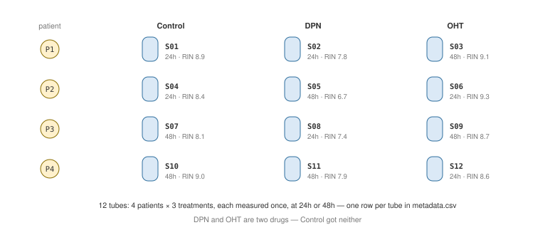

```{r setup, include=FALSE}
# Settings for the whole document. Nothing here is part of today's material,
# and it does not appear in the knitted output -- leave it alone and read on.
knitr::opts_chunk$set(echo = TRUE, collapse = TRUE)
```

New commands get a note like the one below. In the knitted page, notes start closed —
click one to open it.

<details>
<summary>**How to read these notes**</summary>

Each note explains one new piece: what it does, what it takes, and an example. Open one
whenever the code beside it puzzles you — in class, or at 11pm when you are stuck.

</details>

---

# 1. Where you are

RStudio has four panes. Two matter most today.

- **Console** — where code actually runs. What you type here is not saved.
- **Source** — the editor, where this document lives. This is what you keep.

## R has a working directory

R is always "standing" in some folder, and looks for files from there. The grey block
below is a **code chunk** — section 2 explains them; this one is shown, not run.

```{r eval=FALSE}
getwd()
```

Type it in the Console: it prints the folder R is standing in right now. This is the most
common reason a beginner's code fails on someone else's machine — the file is fine, but R
is standing somewhere else.

<details>
<summary>**`getwd()`** — where am I?</summary>

Takes no arguments. Returns the folder R is currently working in, as text.

There is a matching `setwd()` that changes it. **You will see it in a lot of code online,
and it causes trouble:** it hard-codes a path from one computer. Move the folder, rename
it, or send it to a colleague, and every `setwd()` line has to be edited by hand.

</details>

## Three ways to solve it

| Approach | What happens when you share the folder |
|---|---|
| Absolute path — `"C:/Users/yourname/thesis/data/x.csv"` | Breaks on every other machine |
| `setwd("C:/Users/yourname/thesis")` then `"data/x.csv"` | Breaks, one line to fix each time |
| **An RStudio Project** | Works, unchanged |

A Project is just a folder with a `.Rproj` file in it. Opening that file tells R "stand
here". Every path in the course is then written relative to it — `data/metadata.csv` — and
it works on your laptop, mine, and your classmate's. One exception: when you **Knit**
(section 2), R stands in the folder the document is saved in — so keep your documents in
the project folder too, and the two are the same place.

You do not have to use Projects, but one costs a few clicks and saves a lot of trouble:

> **File → New Project → New Directory → New Project**, give it a name, done.

Do it for your thesis, a rotation, anything with more than one file. Put your data in a
`data/` folder inside it and stop thinking about paths.

For today, open the `.Rproj` that came with these files, so we are all standing in the
same place.

---

# 2. This document

You are inside an **R Markdown** file. It holds two kinds of content: prose, and
**code chunks** that actually run.

A chunk starts with three backticks and `{r}`, and ends with three backticks:

````{verbatim}
```{r}
1 + 1
```
````

Which produces:

```{r}
1 + 1
```

The `## [1] 2` underneath is the result. In a knitted file — the web page this document
becomes when you press **Knit**, below — every output line starts with `##`, to tell it
apart from code. The `[1]` is R numbering the output's elements from 1 (some results print
without it). It is never part of the answer.

Above everything sits a short header between two `---` lines: the title and the output
format. Leave it as it is.

The braces can also carry a name and options. The ones this document uses:

- `eval=FALSE` — show the code, do not run it
- `error=TRUE` — let the chunk fail on purpose and carry on
- `warning=TRUE` — show warnings (the default anyway; here it tells you the warning is
  deliberate)
- `include=FALSE` — hide the chunk entirely (the settings chunk at the very top)
- a name starting with `try-`, as in `{r try-a1}` — a chunk that is yours to type

A line like `` in the prose places a picture, and the
`<details>` tags make the collapsible notes. (In the `.Rmd`, the example chunk above is
wrapped in four backticks marked `verbatim` — that is only how this document *shows* a
chunk without running it. You will not need it.)

- **Ctrl/Cmd + Enter** — run the line the cursor is on
- **Ctrl/Cmd + Shift + Enter** — run the whole chunk
- The green ▶ at the chunk's top right does the same thing

Write your notes in the prose between chunks. This is a lab notebook, not a script.

## Knitting

**Knit** turns the whole document — prose, code and results — into one HTML file you can
send to someone. Section 9 covers it.

It matters because knitting runs every chunk from the top, in a fresh session. If your
document knits, it works. If it only works in your console, something in memory is not in
the file.

*Worth knowing:* Bioconductor, home of most of R's software for biological data, documents
its packages in this same format. Packages are next.

---

# 3. Packages

R ships with a small core. Everything else comes in packages, in two steps beginners often
mix up.

**Install once, ever. Load every session.**

## Installing — two ways, same result

By command, in the **Console**:

```{r eval=FALSE}
install.packages("readr")
```

Or by clicking: the **Packages** pane, bottom right → **Install** → type the name →
**Install**. RStudio writes and runs the command above for you.

Either way it is a one-time download. The chunk above is set not to run: an install line
in your document would reinstall the package on every knit.

## Loading — every session

```{r}
library(readr)
```

No output is the correct result.

**readr** — the package for reading data files — is the one you will live in from next
class on. Installing it now means any trouble shows up here, with help in the room, not at
home the night before a deadline.

<details>
<summary>**`install.packages()` vs `library()`**</summary>

`install.packages("readr")` downloads the package onto your computer — like installing an
app. Once.

`library(readr)` makes it available in *this* R session — like opening the app. Every time
you restart R, at the top of your document.

Note the quotes: `install.packages` needs them; `library` does not, though it accepts
them.

</details>

## When it goes wrong

This is the whole list. You will see at least one of these today.

| Message | What happened | What to do |
|---|---|---|
| `there is no package called 'readr'` | Never installed | `install.packages("readr")` |
| `could not find function "…"` | Its package is not loaded — or the name is misspelled | `library()` that package; check the spelling |
| *Do you want to install from sources?* | A newer version exists that would have to be built from its code on your machine | Answer **no** |
| `'lib = "…"' is not writable` | No permission to write to the system-wide package folder — R calls that folder a *library* too | Accept the personal library it offers |

The third one matters: yes starts a long build that often fails. Answer **no**, every
time, all term.

Check which R you are running — a stored value, not a function, so no parentheses. It
should say 4.6.1, the version this course is tested on:

```{r}
R.version.string
```

---

# 4. Vectors

Almost everything in R is a vector, so this is where we start.

## Assignment

```{r}
x <- c(10, 20, 30, 40, 50)
x
```

<details>
<summary>**`<-`** — the assignment arrow</summary>

`x <- 10` means "put 10 into `x`". It is R's version of `x = 10` in Python.

`=` also works for assignment in most places, but R code uses `<-` — and keeping them
apart helps once you meet function arguments, where `=` means something else.

**Shortcut: Alt + −** (Alt and the minus key) types `<-` for you.

</details>

<details>
<summary>**`c()`** — combine values into a vector</summary>

Short for **combine**. Takes any number of values, returns them as one vector.

```{r}
c(1, 2, 3)
c("gene", "sample")
c(TRUE, FALSE)
```

A vector holds **one type only**. Mix types and R converts them all to one — see
coercion below.

You will type `c()` more than any other function in R.

</details>

## Making a run of numbers

```{r}
1:5
```

The colon counts from the first number to the second, **including both ends**. You will
use it constantly for ranges.

## Two functions to type constantly

```{r}
length(x)
class(x)
```

<details>
<summary>**`length()` and `class()`** — how many, and what kind</summary>

`length(x)` returns the number of elements.

`class(x)` returns the type: `"numeric"`, `"character"`, `"logical"`, `"data.frame"`,
and so on.

They cost two seconds and catch most mistakes: when something behaves oddly, ask these two
first. Their cousin `dim()` does the same job for tables, in section 7.

</details>

## Naming the elements

Each slot in a vector can carry a name.

```{r}
g <- c(TP53 = 2390, MYC = 1334, ESR1 = 490)
g
```

The names are genes and the numbers are **counts** — how many times the sequencer, the
machine that reads genetic sequence, saw each gene in one tube of cells. Next class says
more about what that measures; today they are numbers with names.

```{r}
names(g)
g["TP53"]
g[["TP53"]]
```

Single brackets keep the name attached; double brackets give the bare number. Section 5
covers brackets properly — except indexing by name, which is taught here.

<details>
<summary>**`names()`** and naming things inside `c()`</summary>

Write `c(name = value, name = value)` and each element carries a label — text stuck to the
side. The vector is still one type and the same length.

`names(g)` returns the labels as a character vector of their own, so you can subset *it*
with everything in section 5.

Names are convenient, not powerful. Once each gene needs more than one value — a count
*and* a pathway, say — you want a data frame (section 6).

</details>

## Vectorization is free

Operations apply to every element at once. No loop, no library.

```{r}
x * 2
x > 25
```

Look at the second line: comparing a vector to one number gives one TRUE/FALSE per
element. Section 5 is built on it.

## Type coercion

You know from Python that values have types, and that a list can mix them. An R vector
cannot: it holds one type only, so when you mix types R **converts them — silently, with
no error.**

*Predict: what type is `c(1, 2, "three")`?*

```{r try-coercion}
```

Everything became text, silently — text is the only type that can hold all three. Types
convert upward: logical → numeric → character.

```{r}
c(1, 2, TRUE)
```

`TRUE` became `1`. That is useful:

```{r}
sum(c(TRUE, TRUE, FALSE))
```

`sum()` adds up a vector, and TRUE counts as 1 — so this counts how many are true. You
will see it constantly.

## Recycling

If two vectors are different lengths, R repeats the shorter one.

*Predict `c(1, 2, 3, 4) + c(10, 20)` before running it.*

```{r try-recycling}
```

No error. No warning. An answer.

```{r warning=TRUE}
c(1, 2, 3) + c(10, 20)
```

That one warns, because 3 is not a multiple of 2 — but it still returns a result.

> **The point:** where you might expect an error, R gives an answer. Nearly every R bug
> you will write looks like this — not a crash, a plausible number.

## Missing values

```{r}
y <- c(10, 20, NA, 40)
mean(y)
mean(y, na.rm = TRUE)
```

`NA` means unknown. The average of something unknown is unknown, so `mean()` says so.
That is the design, not a bug — and `na.rm = TRUE` is you promising you know what you
are ignoring.

<details>
<summary>**`mean()`** — and the `na.rm` argument</summary>

`mean(x)` adds up a numeric vector and divides by its length.

If even one value is `NA`, the answer is `NA`: you do not know the average of numbers you
do not have.

`mean(x, na.rm = TRUE)` removes the missing ones first. Use it once you have decided they
are safe to ignore — it is a decision, because the number changes.

`sum()`, `median()`, `min()`, `max()` and `sd()` all take `na.rm` and all behave the
same way.

</details>

---

# 5. Subsetting and logical operators

The most useful thing today, and where R differs most from Python.

## Square brackets

```{r}
x
x[1]
```

**Counting starts at 1.**

```{r}
x[2:4]
```

**Ranges include both ends** — three elements, not two.

```{r}
x[-1]
```

**A negative index removes.** In Python `-1` means "the last item"; here it means
"everything except the first". A perfectly good answer — just not the one you meant.

The last element is:

```{r}
x[length(x)]
```

## Subsetting by condition

This is the one that matters. You can index with TRUE/FALSE:

```{r}
x[c(TRUE, FALSE, TRUE, FALSE, TRUE)]
```

And a comparison produces exactly that:

```{r}
x > 25
x[x > 25]
```

Read it as: *keep the elements where this is true.* Next class it becomes `filter()` — the
same idea, with a friendlier face.

## Combining conditions

```{r}
x[x > 15 & x < 45]
```

<details>
<summary>**Logical operators** — `&`, `|`, `!`, `%in%`</summary>

- `&` — and — `x > 15 & x < 45`
- `|` — or — `x < 15 | x > 45`
- `!` — not — `!(x > 25)`
- `%in%` — is it one of these? — `x %in% c(10, 30)`
- `==` — equal to — `x == 30`
- `!=` — not equal to — `x != 30`

`==` is comparison. `=` is assignment. Typing one for the other is a rite of passage.

</details>

### `&` is not `&&`

```{r}
x > 15 & x < 45
```

`&` compares element by element and gives you one answer per element — which is what
subsetting needs.

`&&` gives a **single** TRUE/FALSE and is for `if` statements. Used on a vector it is an
error — `logical(1)` in the message means "one TRUE or FALSE":

```{r error=TRUE}
x > 15 && x < 45
```

> **That `## Error` is supposed to be there.** A few chunks fail on purpose, because the
> failure is the lesson. Your copy is fine.
>
> Normally an error stops a knit — that is what makes a knit worth trusting. These chunks
> are marked `error=TRUE` to allow it.

Use `&` and `|` for data. Use `&&` — and `||`, its partner for *or* — only inside `if`,
which section 8 introduces.

### `%in%` is not `==`

Say you want two of three treatments (section 6 says what they are). The natural-looking
version is wrong:

```{r}
treatments <- c("Control", "DPN", "OHT", "Control", "DPN", "OHT")
treatments == c("Control", "DPN")
```

R recycled `c("Control", "DPN")` across six elements and compared them **pairwise** —
position 1 against `"Control"`, position 2 against `"DPN"`, position 3 against
`"Control"` again. It answered a question you did not ask, without complaint.

What you meant:

```{r}
treatments %in% c("Control", "DPN")
```

**Use `%in%` whenever you are testing against more than one value.**

### `NA` spreads

```{r}
z <- c(5, NA, 15)
z > 10
z[z > 10]
```

An unknown value compared to 10 is unknown, so you get `NA` — and subsetting with an `NA`
returns a **phantom `NA`** in that position rather than dropping it. (On a data frame the
same thing arrives as a whole row of `NA`s — Practice B's worked answers count them.) The
fix:

```{r}
z[which(z > 10)]
```

`which()` turns TRUE/FALSE into positions, and positions cannot be `NA`.

## Finding the missing values

Before deciding what to do about `NA`s, find them.

```{r}
is.na(z)
sum(is.na(z))
z[!is.na(z)]
```

<details>
<summary>**`is.na()`** — the only way to test for missing</summary>

`is.na(x)` returns TRUE/FALSE for each element: is this one missing?

**You cannot test for `NA` with `==`.** This looks reasonable and never works:

```{r}
z == NA
```

Every answer is `NA`: "is 5 equal to an unknown value?" is itself unknown. That is why
`is.na()` exists.

Two things follow:

- `sum(is.na(x))` counts the missing values, because TRUE counts as 1
- `x[!is.na(x)]` keeps everything that is *not* missing

</details>

---

# PRACTICE A — subsetting and logical operators

Type these yourself. Predict the answer first, then run.

```{r}
counts_a <- c(TP53 = 2900, MYC = 4100, IL6 = 60, ACTB = 75000, ESR1 = 480)
counts_a
```

**A1.** How many elements does `counts_a` have, and what class is it?

```{r try-a1}
```

**A2.** Pull out the count for `MYC`.

```{r try-a2}
```

**A3.** Keep only the genes with counts above 1000.

```{r try-a3}
```

**A4.** Keep the genes with counts above 1000 **and** below 50000.

```{r try-a4}
```

**A5.** Keep just `TP53` and `ESR1`, using `%in%` on the names.

```{r try-a5}
```

---

# 6. Data frames

**This is the one to remember.** Nearly all of your analysis life is data frames.

A data frame is a table. Each column is a vector, each column has its own type, and
every column has the same length.

## Build one from scratch

Make one from vectors you already know:

```{r}
gene  <- c("TP53", "MYC", "IL6", "ACTB")
count <- c(2900, 4100, 60, 75000)
keep  <- c(TRUE, TRUE, FALSE, TRUE)

small <- data.frame(gene, count, keep)
small
```

Three vectors, three columns — text, number and TRUE/FALSE in one table. A vector could
not do that.

<details>
<summary>**`data.frame()`** — build a table from columns</summary>

Each argument becomes a column, named after the variable you passed in. You can name
them explicitly instead:

```{r}
data.frame(symbol = gene, n = count)
```

Every column must be the same length — or a length that divides into it evenly, which R
quietly recycles, exactly as section 4 showed. Only a length that does not divide is an
error: *arguments imply differing number of rows*.

</details>

## Getting at the parts

```{r}
small$count
small$count[2]
```

`$` gives you one column, **as a vector**. Everything from sections 4 and 5 applies to
it, because it *is* one of those.

Not the other way round, though — a vector is not a little data frame:

```{r error=TRUE}
counts_a$MYC
```

*Atomic vector* is R's name for a plain vector like `counts_a`. On one of those, use
`counts_a["MYC"]`, or `counts_a[["MYC"]]` for the bare number.

Two indices get you rows and columns: `[rows, columns]`. Leave one blank to mean *all*.

```{r}
small[1, ]
small[, "count"]
small[small$count > 1000, ]
```

That last line is section 5's logical subsetting, with a comma after it. **The comma is
not optional** — leave it out and R thinks you are asking for columns. (The numbers down
the left are the rows' original positions, R's *row names* — labels, not data.)

```{r error=TRUE}
small[small$count > 1000]
```

## Reading one from a file

The rest of today uses a file describing twelve samples from a small experiment. A
**sample** is one tube of cells: from one patient, given one treatment, measured once, 24
or 48 hours later. Four patients × three treatments = twelve tubes, one row each.

| Column | What it holds |
|---|---|
| `sample` | The label on the tube, `S01` to `S12` |
| `patient` | Which of four patients it came from, `P1` to `P4` |
| `treatment` | `Control`, `DPN` or `OHT`. DPN and OHT are two drugs; Control got neither |
| `time` | Measured 24 or 48 hours after treatment |
| `rin` | RNA Integrity Number, 1 to 10. Higher means less degraded RNA; below about 7 is a worry |

All twelve, laid out:

{width=100%}

```{r}
meta <- read.csv("data/metadata.csv")
class(meta)
```

A data frame, like the one you built — twelve rows instead of four, read from disk instead
of typed.

<details>
<summary>**`read.csv()`, and the other one, `read_csv()`**</summary>

`read.csv()` is built into R. Nothing to install, always there.

`read_csv()` comes from **readr**, installed in section 3. It is faster on large files,
reports the column types as it reads, and hands back a *tibble*: a data frame that prints
more compactly and complains more usefully. Almost everything about data frames here
applies to it; next class shows where it differs.

The dot-versus-underscore split runs right through R and catches everyone: `read.csv` /
`read_csv`, `write.csv` / `write_csv`. AI assistants generate both, often in the same
script. When R "could not find function", check which spelling you typed.

</details>

---

# 7. Looking at a data frame

Four functions, every time you load anything. This is the reflex.

*Predict: how many rows and columns?*

```{r try-dim}
```

```{r}
str(meta)
```

```{r}
head(meta)
```

```{r}
summary(meta)
```

<details>
<summary>**`dim()`, `str()`, `head()`, `summary()`**</summary>

`dim()` — rows and columns, in that order. It hands back two numbers, so `dim(meta)[1]`
is the row count on its own. Check it before and after every operation that could change
the shape of your data. This habit catches more bugs than anything else in the course.

`str()` — *structure*. The most informative one: every column, its type, and its first
few values. When something is behaving strangely, `str()` first. It abbreviates: `obs.`
are rows, `variables` are columns, `chr` is character and `num` is numeric.

`head()` — the first six rows. `tail()` gives the last six.

`summary()` — a per-column digest, and it treats number and text columns differently.

A number column gets the minimum, first quartile, median, mean, third quartile and maximum
— plus an `NAs` line with the count whenever a value is missing. The quartiles sit a
quarter and three quarters of the way through the sorted values, so with the median they
show the spread, not just the middle.

A text column has no average, so it gets `Length`, `N.unique`, `N.blank`, `Min.nchar`,
`Max.nchar`: how many entries, how many *different* values, how many blank, and the number
of characters (`nchar`) in the shortest and longest entry.

</details>

## Counting things: `table()`

```{r}
table(meta$treatment)
```

Give it a column, get back how many of each value. You will use it every day: it answers
the question you have most often — *what is in this column, and how much of it?*

Give it two columns and you get a cross-tabulation:

```{r}
table(meta$treatment, meta$time)
```

Rows are the first column you passed, columns the second. Every cell is 2: the experiment
is **balanced** — every treatment at both timepoints, twice. One line, and you have
checked the design.

<details>
<summary>**`table()`**</summary>

`table(x)` counts how many times each value appears. `table(x, y)` cross-tabulates two
columns against each other.

It only **counts**. An average per group is a different job — next class.

`table()` ignores `NA` by default, which is a trap when you are checking data quality
rather than reporting. `table(x, useNA = "ifany")` shows the missing ones too.

</details>

## Look at it: plots with no packages

R draws plots out of the box. These are not pretty and they are not for publication —
they are for *you*, in the ten seconds after loading a file.

```{r}
hist(meta$rin)
```

```{r}
barplot(table(meta$treatment))
```

<details>
<summary>**`hist()` and `barplot()`**</summary>

`hist(x)` — the distribution of one numeric column. How spread out is it, where does it
sit, is there anything odd at the edges.

`barplot(table(x))` — counts per category. Note what it takes: a `table()`, not the raw
column. `barplot()` draws the numbers you give it, and `table()` is what turns a column
of text into numbers.

Class 6 replaces both with **ggplot2**, which is what you will use for anything anyone
else sees. These stay useful forever for the quick look.

</details>

---

# 8. Functions and flow control

A fast pass. You will read these far more often than you write them.

## Writing a function

```{r}
percent <- function(part, whole) {
  part / whole * 100
}

percent(8, 12)
```

Arguments can have defaults:

```{r}
flag_low <- function(rin, threshold = 7) {
  rin < threshold
}

flag_low(6.7)
flag_low(6.7, threshold = 6)
```

<details>
<summary>**`function()`**</summary>

```
name <- function(arg1, arg2 = default) {
  # the last line's value is what comes back
}
```

R returns the value of the last line automatically. `return(x)` exists, but you will
rarely see it.

An argument with a default, like `threshold = 7`, can be left out when you call the
function. To set it, name it — `flag_low(6.7, threshold = 6)` — the same way
`mean(y, na.rm = TRUE)` sets `na.rm`.

</details>

## `if`

```{r}
r <- 6.7

if (r < 7) {
  "flag for review"
} else {
  "fine"
}
```

`if` needs exactly one TRUE or FALSE — which is why `&&` and `||` belong here and `&`
and `|` belong in your data.

## `for`

The simplest loop walks the values themselves:

```{r}
for (v in x) {
  cat(v, "\n")
}
```

Read it as: *for each value in `x`, call it `v`, and do this.*

<details>
<summary>**`cat()`** — print something as you go</summary>

`cat()` prints its arguments to the console with a space between each, and adds no line
break of its own — hence the `"\n"`. Inside a string, backslash-n means *new line*;
without it every pass of the loop would run into the one before.

It is for watching a loop happen, not for returning a value.

</details>

Sometimes you need the position as well as the value. Then loop over the positions and
index into the vector:

```{r}
for (i in seq_along(x)) {
  cat(i, x[i], "\n")
}
```

<details>
<summary>**`seq_along()`** — and why not `1:length(x)`</summary>

`seq_along(x)` gives the positions `1, 2, ... length(x)`.

You will see `1:length(x)` everywhere instead. It is the same thing right up until the
vector is empty:

```{r}
empty <- c()
seq_along(empty)
1:length(empty)
```

`seq_along()` gives nothing — `integer(0)` means "no whole numbers" — so a loop over it
runs zero times, which is correct. `1:length()` counts *down* from 1 to 0, so the loop
runs twice over a vector with nothing in it. Real code ships with that bug.

</details>

## But usually you do not need a loop

Most jobs you would loop over, section 4's vectorization does in one line:

```{r}
paste(meta$sample[1:3], "->", meta$treatment[1:3])
```

One line, no loop, three results.

<details>
<summary>**`paste()`** — glue text together</summary>

`paste()` takes pieces of text and joins them, putting a space between each by default:

```{r}
paste("sample", "S01")
```

Like most of R, it is vectorized. Give it vectors and it works down them in
step, returning one result per element:

```{r}
paste(c("S01", "S02"), "is", c("Control", "DPN"))
```

`paste0()` is the same thing with no separator, which is what you want for building file
names:

```{r}
paste0("results/", "qc_pass", ".csv")
```

Use `sep = "_"` to choose a different separator, or `collapse = ", "` to squash the whole
result into a single string.

</details>

You are learning loops so you can read other people's code — and AI's, which writes them
constantly. Idiomatic R rarely needs one.

---

# 9. Saving your work

## Writing results to a file

```{r}
dir.create("results", showWarnings = FALSE)

good <- meta[meta$rin > 8, ]
write.csv(good, "results/high_rin_samples.csv", row.names = FALSE)
```

`dir.create()` makes the folder; `showWarnings = FALSE` stops it complaining if the
folder is already there. Then the path is relative to your project, so this works on
anyone's machine.

<details>
<summary>**`write.csv()`**</summary>

`write.csv(data, "path/name.csv", row.names = FALSE)`.

Without `row.names = FALSE`, R writes the row names out as a column of numbers that
whoever opens the file will take for data. readr's `write_csv()` leaves them out by
default.

Keep results in a `results/` folder, separate from `data/`. Then "which files did I
make and which did I receive" never becomes a question.

</details>

## Knitting the report

Press **Knit**, at the top of the editor.

You get one HTML file — prose, code and every result — that you can email to a supervisor.
It is how work is handed in on this course, final project included.

It runs the whole document from scratch in a clean session: if it knits, it works.

---

# PRACTICE B

## Part 1 — read the code and fix it

Each chunk below is broken, or worse, quietly wrong. Work out what it is *meant* to do,
say what actually happens, then fix it.

**B1.** Meant to keep the rows where RIN is above 8.

```{r error=TRUE}
meta[meta$rin > 8]
```

```{r try-b1}
```

**B2.** Meant to keep the Control and DPN samples. This one runs — and gives a wrong
answer without complaint.

```{r}
meta[meta$treatment == c("Control", "DPN"), ]
```

```{r try-b2}
```

**B3.** Meant to keep samples with RIN above 8 taken at 24h.

```{r error=TRUE}
meta[meta$rin > 8 && meta$time == "24h", ]
```

```{r try-b3}
```

## Part 2 — start from nothing

This time you start from an empty document.

### The file you will be working with

`data/qc_samples.csv` is a sample QC (quality-control) sheet — the kind of table a
sequencing facility hands back with your samples. You have not seen it before. It has
seven columns:

| Column | What it is |
|---|---|
| `sample_id` | The label on the tube |
| `patient` | Which patient the sample came from — a patient can give more than one |
| `age` | Patient age in years |
| `sex` | `F` or `M` |
| `batch` | Which run it was processed in: `A`, `B` or `C` |
| `rin` | RNA Integrity Number, 1 to 10. Higher is less degraded; below about 7 is a worry |
| `qc_score` | The facility's overall quality score, 0 to 100 |

It is built to look like the real thing, which means nobody has cleaned it up for you.
Look at it before you trust it.

### Where the file goes

Save your new document **in the project folder** — the one with the `.Rproj` in it, next
to this document. That is what makes `data/qc_samples.csv` work as written. Save it to
Desktop or Downloads and that path finds nothing: when you knit, R stands in the
document's folder, and there is no `data/` there.

### The tasks

1. **File → New File → R Markdown**, give it a title, **OK**. Delete the example content
   below the first chunk. Save it into the project folder as `practice-b.Rmd`.
2. Read `data/qc_samples.csv` — the path exactly as written here.
3. How many rows and columns? Then `summary()` it, and read every line.
4. How many rows in each batch? How many of each sex? (Rows, for now — whether every row
   is a different sample is something the worked answers come back to.)
5. What is the mean RIN? **Look hard at the answer before you move on.**
6. How many rows have RIN above 8 *and* a QC score above 70?
7. Draw a histogram of the QC scores.
8. Write the samples that pass step 6 to `results/qc_pass.csv`.
9. **Knit it, and show me the work.**

<details>
<summary>Worked answers — try it first</summary>

```{r}
qc <- read.csv("data/qc_samples.csv")
dim(qc)
```

```{r}
summary(qc)
```

```{r}
table(qc$batch)
table(qc$sex)
```

Step 5, the one to look hard at:

```{r}
mean(qc$rin)
```

`NA`. Two samples have no RIN recorded, so the mean is unknown until you say what to do
about them:

```{r}
sum(is.na(qc$rin))
mean(qc$rin, na.rm = TRUE)
```

Step 6. The question asks *how many*, which is one number:

```{r}
pass <- qc[which(qc$rin > 8 & qc$qc_score > 70), ]
dim(pass)[1]
```

`dim()` gives rows and columns; `[1]` takes the first of the two.

```{r}
hist(qc$qc_score)

dir.create("results", showWarnings = FALSE)
write.csv(pass, "results/qc_pass.csv", row.names = FALSE)
```

**Three things are hiding in this file.** None raises an error; each shows only if you
read the output line by line. That is what looking before you trust means.

`duplicated()` walks a vector and asks, of each value, *have I seen this one already?*
Counting the TRUEs counts the repeats, and subsetting with them names the repeat:

```{r}
sum(duplicated(qc$sample_id))
qc$sample_id[duplicated(qc$sample_id)]
```

There are 25 rows but only 24 samples — one tube is in the sheet twice. Row counts and
sample counts are not the same number, and nothing warned you. That tube, `Q07`, is one
of the rows that passed step 6 — so `pass` has 14 rows and 13 samples, and step 8 wrote
the duplicate into `results/qc_pass.csv` without a word.

```{r}
dim(qc[qc$rin > 8, ])[1]
dim(qc[which(qc$rin > 8), ])[1]
```

The second is the two missing RINs again. Filtering on `rin > 8` alone gives 16 rows; with
`which()`, 14. The missing RINs came back as phantom `NA` rows, as in section 5. In step 6
they happen to be harmless — both samples fail the QC-score test, and `NA & FALSE` is
`FALSE` (false and anything is false, whatever the unknown is) — so leaving `which()` out
there still gives 14. The `which()` is there so the answer does not depend on that luck.

The third is quiet: `summary(qc)` shows an `NAs` line under `age`, count 1. One age is
missing. It changes nothing today — but until `summary()` said so, you did not know.

</details>

# Where we are going

Next class we stop writing `meta[meta$rin > 8, ]` and start writing
`filter(meta, rin > 8)` — the same question, better named — and you meet the gene counts
measured in these same twelve tubes, in a file shaped differently from anything you have
seen today.

## The habit to take with you

The habit that will save you the most time this term:

> **Before you run something, guess what shape the answer will be. Then check.**

How many rows should come back? How many columns? One number, or a vector? Then run
`dim()`, `length()` or `class()` and find out.

You will be wrong often at first, and each time you learn something real about R. More
importantly, when prediction and result disagree, you have found a bug — usually before it
cost you anything.

That is the whole defence against the failure mode you saw all through today. Not a
crash. A plausible number.

## Before next class

Two things.

**Install the packages next class runs on.** In the Console:

```r
install.packages("tidyverse")
```

It is a large download — dozens of packages — so start it and leave it alone. If it asks
whether to install from sources, say **no**, same as always. Do this at home, not in the
room: it takes a while, and we start using it in the first ten minutes.

**Then check it.** In the Console, `library(tidyverse)` should list the packages it
attaches, with no error. Then knit this document and your `practice-b.Rmd`. If both
produce HTML files, you are ready for Class 5.
