```{r setup, include=FALSE}
# Settings for the whole document. Nothing here is part of today's material,
# and it does not appear in the knitted output -- leave it alone and read on.
knitr::opts_chunk$set(echo = TRUE, collapse = TRUE)
```

Same collapsible notes as last time: the explanation beside the first use, closed until you want it.

---

# 1. Where you are

Last class you had the sample sheet in a data frame, `meta` — twelve samples, one row
each; its `rin` column scores how intact each sample's RNA is, 1 to 10. You learned to say
this:

```{r eval=FALSE}
meta[meta$rin > 8, ]
```

Today you learn to say this:

```{r eval=FALSE}
filter(meta, rin > 8)
```

The same question. The second is easier to read and to chain, and it is how most R written
in the last ten years looks — including most of what an AI writes for you. Not all of it,
as the end of today shows, so you need to read both.

That is most of today. Before it: what is in the three files, and the one table layout
every tool assumes. After it: the same data in more than one shape, two tables joined into
one, and looking at data before you trust an answer about it.

## The packages

```{r}
library(readr)
library(dplyr)
library(tidyr)
```

Watch what `dplyr` prints.

<details>
<summary>**Masking** — why `dplyr` prints a warning that is not a warning</summary>

Loading `dplyr` prints two blocks of this:

```
The following objects are masked from 'package:stats':
    filter, lag

The following objects are masked from 'package:base':
    intersect, setdiff, setequal, union
```

R already had a `filter()` — a signal-processing function in `stats` — and a `setdiff()`,
in `base`. Now there are two of each, and the one loaded last wins.

Normal, not an error: R is telling you which one you get. It matters only when the one you
wanted is not the one that won. If a function ever behaves nothing like its documentation,
check this first.

`package::function()` forces the issue: `stats::filter()` gets you the old one.

</details>

<details>
<summary>**The three packages, and what each is for**</summary>

- **`readr`** — reading and writing data files. `read_csv()`, `write_csv()`.
- **`dplyr`** — the verbs for working on a table: filter, select, mutate, arrange, and
  group-then-summarise.
- **`tidyr`** — changing the *shape* of a table: `pivot_longer()`, `pivot_wider()`.

All three are part of the **tidyverse**, a family of packages designed together.
`library(tidyverse)` loads these three plus a few others in one line. Loading them
separately makes it clear which package each function came from.

If a `library()` line fails with *there is no package called …*, the package is not
installed. `install.packages("tidyverse")` in the Console installs all three — a large
download, so do it before class.

</details>

---

# 2. What you have, and what you do to it

## The three files

Everything today is a question put to one of three files, or to two of them joined. So
before any tool: what is in each, in plain words.

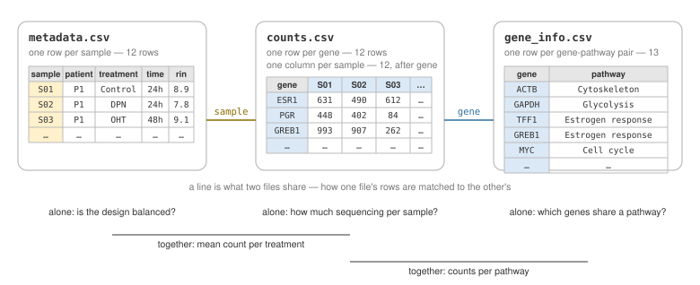{width=100%}

| File | One row per | What it tells you | Questions it can answer on its own |
|---|---|---|---|
| `metadata.csv` | sample — twelve of them | who the sample came from (`patient`), what was done to it (`treatment`, `time`), how intact its RNA was (`rin`) | Is the design balanced, as Class 4 asked? Which samples are good enough to use? |
| `counts.csv` | gene — twelve, with one column per sample | how many pieces of each gene's RNA were read in each sample: a **count** — the list below says how | How much sequencing did each sample get? Which genes dominate? |
| `gene_info.csv` | gene–pathway pair — thirteen | which biological process each gene is part of | Which genes share a pathway? Which are in more than one? |

Some questions need a column from two files: *mean count per treatment* needs `counts` and
`metadata`; *counts per pathway* needs `counts` and `gene_info`. Combining two files on a
column they share is a **join**, and the shared column is the **key**. (In `counts` the
samples are column *headers*, not a column — section 6 fixes that.) Joins are where
trouble starts; section 7 does them properly.

A few words you will hear all day. The picture behind most of them first:

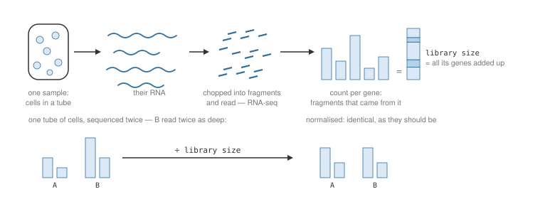{width=100%}

- **Sample** — one tube of cells: one patient, one treatment, one **timepoint** (24 or 48
  hours after the treatment began). Twelve of them, pictured in Class 4.
- **Treatment** — what was done to the cells. `Control` is nothing. `DPN` and `OHT` are
  two drugs, and both act on the estrogen receptor — the protein a cell uses to respond
  to estrogen. `OHT` blocks it; `DPN` stimulates it. That is all the pharmacology today
  needs.
- **Gene** and **count** — a gene is one stretch of the cell's DNA, copied into RNA
  whenever the cell uses it: *expressing* the gene. Sequencing chops a sample's RNA into
  fragments and reads millions of them; each is a **read**, and the technique is
  **RNA-seq**. A gene's count is how many reads came from it. More of a gene's RNA means a
  bigger *share* of the reads — roughly, more *expression*. So a count is a gene's share
  of the reads, not an amount of RNA: how many reads a sample gets in total is decided by
  the sequencing, not by the cells. A full run reports thousands of genes; this file keeps
  twelve.
- **Library size** — a sample's total count: how much sequencing it got, also called its
  **depth**. Here it is the total across this file's twelve genes; a full run counts
  millions of reads. (A sample's RNA, readied for the sequencer, is its *library*.) Read
  two identical samples to different depths and every gene's count differs, so every
  comparison has to correct for it — and nothing in these files has been corrected.
  Dividing each count by its sample's library size puts the samples on one scale:
  **normalising**.
- **Housekeeping gene** — a gene every cell runs constantly, whatever is done to it. Two
  are in here: `ACTB`, the cell's scaffolding, and `GAPDH`, sugar metabolism. Their counts
  are enormous and tell you nothing about a treatment.
- **Pathway** — a named group of genes that work on one process. A gene can be in several,
  or in none anyone has written down. The ten names in this file are just labels today
  (EMT, for instance, is epithelial–mesenchymal transition, a switch in cell type).
- **RIN** — RNA integrity number, 1 to 10: how intact the RNA was before sequencing.
  Higher is better.

Two of those words — housekeeping genes and pathways — drawn from the files: every count
in `counts.csv` totalled per gene, and every row of `gene_info.csv` as a line, with the
genes that have no row marked:

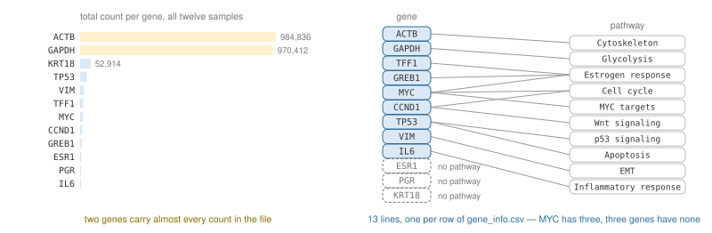{width=100%}

## If none of that has settled

Hold one picture instead; most of the words above hang off it.

Every cell carries the same cookbook — the genome — and a **gene** is one recipe. A gene
being *expressed* means the kitchen prints tickets for that recipe. The tickets are the
RNA — messenger RNA, the working copies. The cook turns tickets into the dish: a protein.
A busy recipe has hundreds of tickets out; one nobody ordered has none.

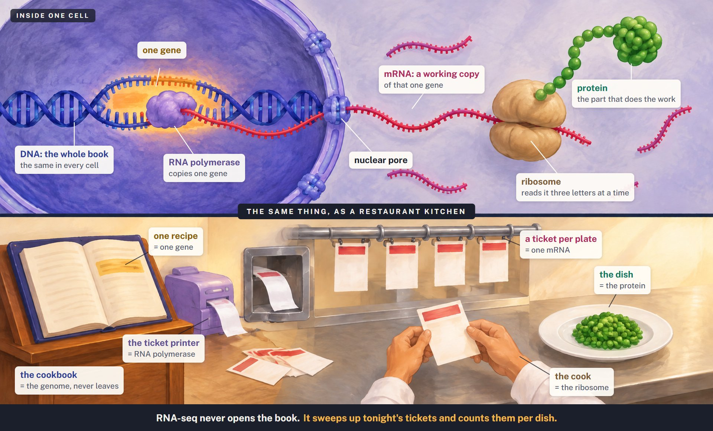{width=100%}

You cannot watch the kitchen. What you can do is sweep up the tickets, shred them, read
the shreds, and assign each one to its dish. More tickets, more shreds: shreds per dish is
the **count**, and that is **RNA-seq**. Every dish comes from one recipe, so counting per
dish is counting per gene. And it is a count of ticket shreds, never of the food: RNA, not
protein.

Step by step, in kitchen words and real ones:

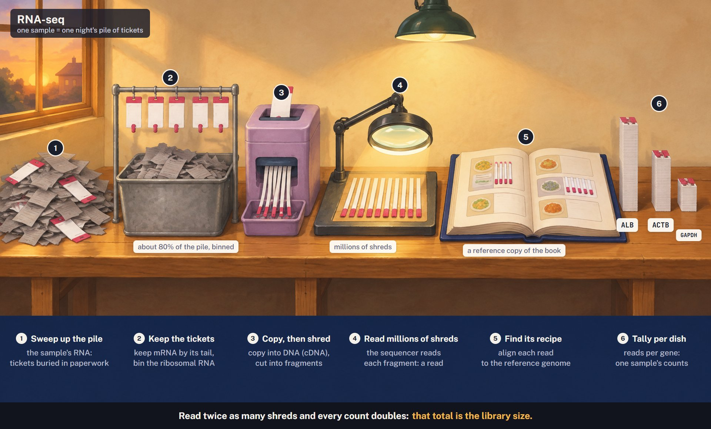{width=100%}

Every cell has the same book, so what tells a liver cell from a pancreas cell is its
tickets:

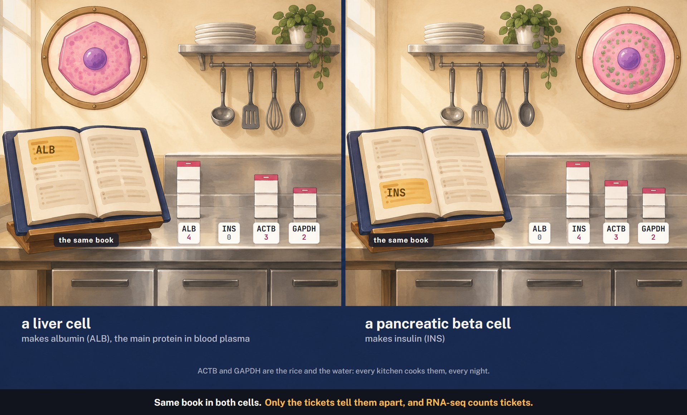{width=100%}

- A **sample** is one tube of cells — hundreds of thousands of these kitchens — and its
  pile is their night's tickets, swept together when the tube was taken. The cells came
  from four patients, and each patient's cells were split three ways, one per treatment:
  twelve piles, each taken one day or two after the treatment began. That is the
  **timepoint**: how long the treatment had to act.
- **Library size** is how many shreds you read from a pile, counting only the dishes in
  this file. Read twice as many and every dish's count doubles, though nothing about the
  cooking changed. So compare each dish's *share* of its own pile, never the raw shreds:
  **normalising**.
- **Housekeeping genes** are the rice and the water: ordered with every meal, every night.
  Their tickets are in every pile — and in these files they dominate, so any average
  across dishes is mostly a statement about rice.
- **Pathways** are the sections of the menu. A dish can sit under several sections, and
  this menu leaves some dishes out of every section — which the joins, later today, find
  out the hard way.
- A **treatment** is something done to the kitchens that changes which dishes get ordered.
  The question worth asking: which dishes were ordered more, or less, and by how much,
  once you allow for how many shreds you read.

Twelve of what? The sample sheet has one row per **pile** — one tube of cells; the counts
file has one row per **recipe** — one gene. Keep that difference in mind; it matters the
moment the second file is opened.

Now the first of them on screen, and the picture of the table every tool today assumes.

```{r}
meta <- read_csv("data/metadata.csv", show_col_types = FALSE)
meta
```

<details>
<summary>**`read_csv()`** — and what `show_col_types` is doing there</summary>

`read_csv("path/file.csv")` reads a CSV file. Same job as Class 4's `read.csv()`.

Leave off the second argument and it reports what type it decided each column is:

```
Rows: 12 Columns: 5
── Column specification ──────────────────────
Delimiter: ","
chr (4): sample, patient, treatment, time
dbl (1): rin

ℹ Use `spec()` to retrieve the full column specification for this data.
ℹ Specify the column types or set `show_col_types = FALSE` to quiet this message.
```

Worth reading the first time you open a file: `chr` is text, `dbl` a number, and a column
you expected to be numeric showing up as `chr` means something in it is not a number.
After that it is noise, and `show_col_types = FALSE` — as its last line says — turns it
off. The data is unchanged.

</details>

<details>
<summary>**The tibble** — what `read_csv()` hands back</summary>

The printout's first line says `A tibble: 12 × 5`. A **tibble** is a data frame:
`class(meta)` ends in `"data.frame"`, and every bracket, `$` and function from last class
still works on it.

It is the tidyverse's version, with three differences you will notice:

- **It will not flood your console.** Up to twenty rows it prints them all; past that,
  ten, and says how many there were. A plain data frame with 10,000 rows floods the
  console with thousands of lines. The column types sit under the names — `<chr>` text,
  `<dbl>` a number, `<int>` a whole number, `<lgl>` TRUE or FALSE.
- **One column stays a table.** `meta[, 1]` on a plain data frame hands you back a
  *vector*; on a tibble it hands you a one-column tibble. Class 4 was full of R quietly
  changing the shape of things — this is one place it refuses to.
- **It will not guess at a half-typed column name.** `meta$treat` on a plain data frame
  silently returns the `treatment` column. On a tibble it returns `NULL` — R's word for
  "nothing here" — and warns you. The first is how a typo becomes a result. Try both:
  `as.data.frame(meta)` gives you the plain version.

Run `class(meta)` and you get four entries, `"spec_tbl_df" "tbl_df" "tbl" "data.frame"`:
`spec_tbl_df` is readr's record of the column types it guessed; the middle two make it a
tibble; the last is what it still is. The verbs hand back tibbles too, some with that
readr entry and some without — the last entry is always `"data.frame"`.

</details>

## Tidy

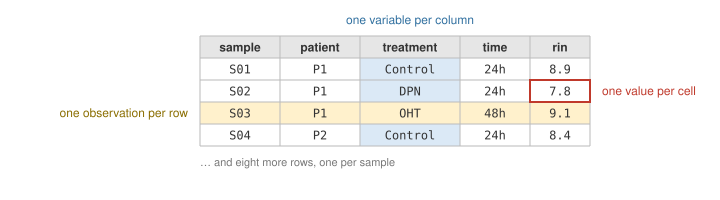{width=100%}

Look at how `meta` is laid out. Every **column** is one variable — one thing recorded
about each sample. Every **row** is one observation — one sample, everything recorded
about it. Every **cell** holds one value.

That layout is called **tidy**, and every tool today assumes it. `filter()` can keep "the
samples with RIN over 8" only because each sample is a row and RIN is a column; splitting
the table by treatment works only because treatment is a column. When a table is not tidy
— you will meet one shortly — the first job is to make it so.

## The verbs

Here are the verbs: five operations, each doing one thing to a tidy table, each handing
you a table back:

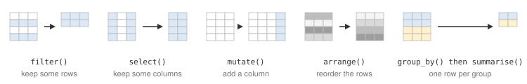{width=100%}

You reach for each one because of a question:

| The question | The verb | What it does to the table |
|---|---|---|
| Which samples have RIN over 8? | `filter()` | keeps some **rows** |
| Show me only the sample, its treatment and its RIN | `select()` | keeps some **columns** |
| Flag the samples with RIN over 8 | `mutate()` | adds a **column**, computed from the others |
| Which sample has the worst RNA? | `arrange()` | puts the **rows** in order |
| What is the mean RIN per treatment? | `group_by()`, then `summarise()` | collapses the rows to **one per group** |

Table in, table out — so they chain: one verb's output is the next one's input. Most of
every analysis today is a sequence of these five.

Two more things happen to tables, each in its own section: a table can be **reshaped**
(the same values, a different layout), and two tables that share a column can be
**joined** into one.

---

# 3. The arc

Before the detail, one whole analysis at full speed.

**Do not write this down, and do not worry about the syntax** — section 4 explains every
line. Watch the shape: every analysis you do this term has it.

```{r}
meta <- read_csv("data/metadata.csv", show_col_types = FALSE)

meta |>
  filter(rin > 7) |>
  group_by(treatment) |>
  summarise(n = n(), mean_rin = mean(rin)) |>
  arrange(desc(mean_rin))
```

Read it aloud: take the metadata, **and then** keep the samples with RIN above 7, **and
then** group by treatment, **and then** count them and average their
RIN, **and then** sort, largest first.

Note the column `n`: 4, 4 and 3 — how many samples went into each row. One DPN sample did
not survive the filter, and you know only because the count sits next to the average. That
is the argument for putting it there.

One sentence, and no in-between variables named `meta2` and `meta2_filtered_final`.

---

# 4. The verbs, and the pipe

The first four do nothing `[ ]` and `$` could not. Their point is that you can read them a
year later. Each comes with the question it answers.

## `filter()` — keep some rows

*Which samples have RIN over 8?*

```{r}
filter(meta, rin > 8)
```

The Class 4 way, for comparison:

```{r}
meta[meta$rin > 8, ]
```

Same rows. Two differences worth noticing: no `meta$` in front of `rin`, and no lonely
comma to forget.

<details>
<summary>**`filter()`** — keep the rows where a condition is TRUE</summary>

`filter(data, condition)`. Inside `filter()` you name columns bare — `rin`, not
`meta$rin` — because it already knows which table you mean.

Several conditions, comma-separated, all must hold:

```{r}
filter(meta, rin > 8, treatment == "Control")
```

A comma means **and**. You can also write `&` yourself, and `|` for or. The logical
operators from Class 4 all work here, `%in%` included:

```{r}
filter(meta, treatment %in% c("Control", "OHT"))
```

**`filter()` drops `NA` rows silently.** If a sample's `rin` were missing, `rin > 8` would
be `NA` — neither TRUE nor FALSE — and the row would go. Friendlier than `[ ]`, which
gives Class 4's phantom `NA` rows, but "vanished quietly" is still worth knowing.

</details>

## `select()` — keep some columns

*Show me only the sample, its treatment and its RIN.*

```{r}
select(meta, sample, treatment, rin)
```

<details>
<summary>**`select()`** — choose columns by name</summary>

`select(data, col1, col2, ...)`. Bare names, no quotes, no `c()`.

Drop instead of keep with a minus:

```{r}
select(meta, -patient)
```

Rename while selecting, new name on the left:

```{r}
select(meta, sample, quality = rin)
```

`select()` always returns a **table**, even for one column. `meta$rin` returns a
**vector**. That difference bites later; section 5 shows it with `class()`.

</details>

## `mutate()` — add or change a column

*Flag the samples with RIN over 8.* That is a new column — one TRUE or FALSE per sample,
computed from `rin`. *Predict:* `meta` had five columns; how many will this have?

```{r}
mutate(meta, good = rin > 8)
```

The tibble's header says `12 × 6`; `dim()` is the check that works on anything:

```{r}
dim(mutate(meta, good = rin > 8))
```

<details>
<summary>**`mutate()`** — compute a new column from existing ones</summary>

`mutate(data, new_name = expression)`. The expression works on whole columns, named bare:
`rin > 8` gives one TRUE or FALSE per row. An expression that gives a single value, such
as `mean(rin)`, fills every row with it.

```{r}
mutate(meta, rin_rounded = round(rin))
```

(`round()` gives you the nearest whole number.)

Several at once, and later ones can use earlier ones. `paste()` glues text together with
a space between:

```{r}
mutate(meta,
       good = rin > 8,
       label = paste(sample, treatment))
```

Give an **existing** name and you overwrite that column instead of adding one. That is
occasionally what you want and frequently an accident — `dim()` before and after tells
you which.

</details>

## `arrange()` — sort the rows

*Which sample has the worst RNA?*

```{r}
arrange(meta, rin)
```

S05, at 6.7. Largest first:

```{r}
arrange(meta, desc(rin))
```

And by two columns — within each treatment, best RNA first:

```{r}
arrange(meta, treatment, desc(rin))
```

The first column sorts; the second breaks ties.

<details>
<summary>**`arrange()` and `desc()`** — put the rows in order</summary>

`arrange(data, column)` sorts ascending. Wrap the column in `desc()` for descending.

Rows that tie on every sort column keep their original order — sort `meta` by `treatment`
alone and the four Control rows are still S01, S04, S07, S10.

`arrange()` changes the **order** of rows, never how many. If the row count moves, you
did not run `arrange()`.

Missing values go to the bottom, ascending or descending, always.

</details>

## The pipe

Four verbs so far, and each is fine on its own. The problem is using them together.

```{r}
arrange(filter(meta, rin > 8), desc(rin))
```

That reads inside-out, and it gets worse with every step. The pipe fixes it:

```{r}
meta |>
  filter(rin > 8) |>
  arrange(desc(rin))
```

<details>
<summary>**`|>`** — the pipe, said "and then"</summary>

`x |> f()` means `f(x)`. The thing on the left becomes the **first argument** of the
function on the right.

So `meta |> filter(rin > 8)` is exactly `filter(meta, rin > 8)`. That is all it does.

Why it matters: the four verbs all take a table first and return a table, so they chain.
Written with the pipe, the code is in the order you would say it out loud.

You will also meet **`%>%`**, from the `magrittr` package. Same job. Most tidyverse code
written before 2021 uses it, and AI tools writing tidyverse code often still do. `|>` is
built into R. Read both, write `|>`.

**Shortcut: Ctrl + Shift + M** types a pipe for you — `|>` in a current RStudio. If yours
types `%>%`, tick *Use R's native pipe operator, |>* under Tools → Global Options → Code.

Put the `|>` at the **end** of a line, never at the start of the next one.

</details>

## `group_by()` and `summarise()`

*What is the mean RIN per treatment?* Class 4 had nothing like this one.

```{r}
meta |>
  group_by(treatment) |>
  summarise(mean_rin = mean(rin))
```

Twelve rows went in. Three came out — one per treatment.

<details>
<summary>**`group_by()` + `summarise()`** — one row out per group</summary>

`group_by()` marks a column as the grouping. On its own it changes no values; the printout
just gains a `# Groups:` line. `summarise()` then collapses **each group to a single
row**.

```{r}
meta |>
  group_by(treatment) |>
  summarise(mean_rin = mean(rin),
            worst = min(rin))
```

Anything that takes a vector and returns one number works inside `summarise()`:
`mean()`, `median()`, `min()`, `max()`, `sum()`, `sd()`. (`n()` belongs here too, though
it takes no arguments at all — see its note below.) As in `mutate()`, a later column can
use one created earlier in the same call.

Group by two columns and you get one row per combination:

```{r}
meta |>
  group_by(treatment, time) |>
  summarise(mean_rin = mean(rin), .groups = "drop")
```

`.groups = "drop"` tells it to forget the grouping afterwards. Leave it out and R prints
a message reminding you the result is still grouped, which trips up the next step.

If a column has `NA` in it, `mean()` returns `NA` — same as Class 4. `mean(rin, na.rm =
TRUE)` still applies.

</details>

## Always add `n()`

```{r}
meta |>
  group_by(treatment) |>
  summarise(n = n(), mean_rin = mean(rin))
```

Last class the reflex was `dim()`. For grouped data the reflex is **`n()`**, and it is
the same reflex: a mean over four samples and a mean over one sample look identical on
screen, and only one of them means anything.

<details>
<summary>**`n()`** — how many rows in this group</summary>

`n()` takes no arguments and works inside `summarise()`, `mutate()` and `filter()`. It
returns the number of rows in the current group — or, if the data is not grouped, the
number of rows in the whole table.

Put `n = n()` in any `summarise()` whose numbers you will compare across groups — nearly
all of them. When a group turns out to have one row, or eleven when you expected four, you
want to see it on the same screen as the number, not three steps later.

</details>

---

# 5. Subsetting, and saving what you made

The square brackets and `$` from Class 4 have not gone anywhere, and for a quick look they
are still the shortest thing to type.

```{r}
meta[1:3, ]
meta$rin
```

What you want `$` for now is **getting a column out as a vector** — on a tibble, `[ ]` and
`select()` both hand you a table:

```{r}
class(meta$rin)
class(select(meta, rin))
```

## Writing results out

Results go in a folder of their own. `dir.create()` makes it if it is not there, and
`showWarnings = FALSE` keeps it quiet if it already is — the same job `show_col_types =
FALSE` did for `read_csv()`.

```{r}
dir.create("results", showWarnings = FALSE)

good <- meta |> filter(rin > 8) |> arrange(desc(rin))
write_csv(good, "results/class5_good_samples.csv")
```

<details>
<summary>**`write_csv()`, and the dot-versus-underscore split**</summary>

`write_csv(data, "path/name.csv")`. No `row.names = FALSE` to remember. **Row names** are
labels on the rows of a base-R data frame, outside any column; `write.csv()` writes them
as an unnamed first column that whoever opens the file will read as data. Tibbles have
none, so `write_csv()` has nothing to leave out.

There are two of nearly everything:

| base R | readr |
|---|---|
| `read.csv()` | `read_csv()` |
| `write.csv()` | `write_csv()` |

The **dots** are base R, built in, always available, and return plain data frames. The
**underscores** are readr: faster on large files, and they return tibbles.

Both are correct. The difference that bites: `read.csv()` takes `row.names = 1`, which
turns the first column into row labels; `read_csv()` does not, because a tibble has no row
names. AI tools produce both, sometimes in one script — read the underscores carefully.

</details>

---

# 6. The same data, two shapes

Now the second file.

```{r}
counts <- read_csv("data/counts.csv", show_col_types = FALSE)
dim(counts)
```

Twelve by thirteen. `meta` was twelve by five.

Both have twelve *rows*. **They are not the same twelve things.**

```{r}
counts[, 1:4]
```

The twelve rows are **genes**. Twelve of the thirteen columns are the samples — the twelve
that were *rows* in `meta`. The thirteenth, at the front, holds the gene names.

Twelve rows in both, meaning different things — the commonest confusion in biological
data. Every time you open a file, ask: twelve of what?

Each number is a **count**: how many reads landed on that gene in that sample. People talk
about counts as if they were "expression". Most of what goes wrong later today comes from
that.

And it is not tidy. The column names `S01`, `S02`, `S03` … are not variables. They are
*values* of one variable, *which sample*, spread across the top as headers. Every cell is
a count, but no column is called `count` or `sample`.

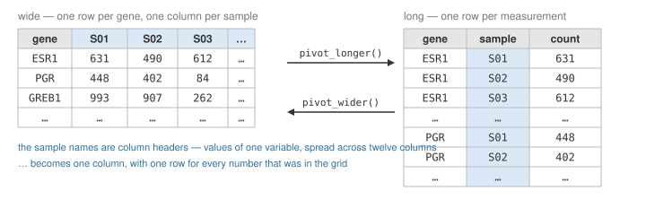{width=100%}

(The two arrows are the two functions this section teaches — one each way.)

Nothing is wrong with the grid — it is how a human reads a table of counts. But the verbs
cannot use it: `group_by(sample)` needs a column called `sample`. So first, change the
shape.

## Long

*Predict first:* if every measurement in that grid gets its own row, how many rows is
that?

```{r}
long <- pivot_longer(counts, -gene, names_to = "sample", values_to = "count")
dim(long)
```

```{r}
head(long)
```

(`head()` shows the first six rows; `head(long, 3)` would show three.)

Twelve genes × twelve samples: every measurement in the grid now has its own row, labelled
with its gene and its sample.

<details>
<summary>**`pivot_longer()`** — one row per measurement</summary>

```r
pivot_longer(data, cols, names_to = "...", values_to = "...")
```

- **`cols`** — the columns to collapse. `-gene` means "everything except `gene`".
- **`names_to`** — name for the new column holding the old column *names*.
- **`values_to`** — name for the new column holding the old *values*.

The row count is the giveaway: collapsing 12 columns of 12 rows gives 12 × 12 = 144.
If your answer is not rows × collapsed-columns, you collapsed the wrong ones.

Long is the tidy layout: what the verbs, the joins and next class's plots want. Wide is
what a human reads, and what some tools require — DESeq2, the standard R package for
*differential expression* — finding the genes whose expression differs between groups —
wants its counts as a grid. Neither is wrong; you will move between them constantly.

</details>

## And back

```{r}
wide_again <- pivot_wider(long, names_from = sample, values_from = count)
dim(wide_again)
```

Twelve by thirteen. Where we started.

<details>
<summary>**`pivot_wider()`** — the inverse</summary>

```r
pivot_wider(data, names_from = ..., values_from = ...)
```

`names_from` is the column whose *values* become new column names; `values_from` is the
column that fills the grid.

**Quotes or not?** `pivot_longer()` takes `names_to = "sample"` in quotes, because you are
inventing a name for a column that does not exist yet. `pivot_wider()` takes
`names_from = sample` bare, because that column already exists. It catches everybody once.

`pivot_wider()` is where duplicates surface. If two rows claim the same gene and the
same sample, there is nowhere to put the second one, and R warns you and packs both
values into the one cell. That warning almost always means a duplicated row upstream.

</details>

## Now it groups

With the counts long, the verbs can ask a question the grid could not take — how many
counts did each sample get in total?

```{r}
long |>
  group_by(sample) |>
  summarise(n = n(), library_size = sum(count)) |>
  arrange(desc(library_size))
```

`n` is 12 for every sample — twelve genes each, nothing missing. That is the check, and it
cost you one argument.

That total is the one from section 2's word list — the sample's **library size**, how much
sequencing that sample received. It is a property of the experiment, not of the biology.

Top and bottom: 250,841 against 123,704 — the deepest sample got **twice** the sequencing
of the shallowest. Nothing about those two samples is twice anything, biologically. Hold
on to that; it comes back.

---

# 7. Joins, and the `dim()` reflex

The counts are now in a shape the verbs can use — and there is a question they still
cannot answer: *what is the mean count per treatment?*

```{r}
head(long, 3)
```

`long` knows the gene, the sample and the count — not the treatment. That lives in `meta`.
The two share one column, `sample`, and a shared column is what lets two tables become
one.

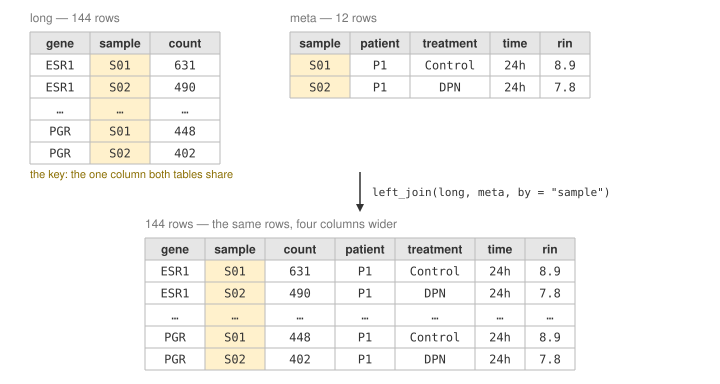{width=100%}

A **join** attaches the columns of one table to the rows of another by matching on a
column they share — the **key**. For every row of `long`, find the row of `meta` with the
same `sample`, and bring its columns across.

*Predict:* `long` is 144 rows. How many after the join?

```{r}
with_meta <- left_join(long, meta, by = "sample")
dim(with_meta)
```

144, and four columns wider: every measurement found exactly one match, because every
sample is in `meta` exactly once. That is what a join should do — **the same rows, more
columns.** The question is now one `group_by()` away, and section 8 asks it. First the
other file, because joins do not always go this way.

## The other file

The third file says what each gene does.

```{r}
gene_info <- read_csv("data/gene_info.csv", show_col_types = FALSE)
gene_info
```

Thirteen rows — but not thirteen genes. There are nine distinct names, so some genes
appear more than once. And nine is not twelve, so at least three genes in `counts` have no
row here — the three the picture in section 2 marked *no pathway*.

Look at a file like this *before* you join it. This time the key, `gene`, is neither
unique nor complete, and each of those does something to the join. There are two joins to
choose from; they differ in what they do with a row that finds no match.

## `left_join()`

```{r}
annotated <- left_join(long, gene_info, by = "gene")
dim(annotated)
```

144 rows went in. **192 came out.**

R warned you as it did it. Read the warning now — `x` is the first table you gave it, `y`
the second — down to its last line, which offers `relationship = "many-to-many"` to make
it stop. *Many-to-many* means the matches run both ways: one row of `long` can match
several rows of `gene_info` (a MYC count, three pathways), and one row of `gene_info`
matches several rows of `long` (one per sample). The warning names one example of each.

Do not take it. The warning is not what needs fixing: it is the only notice you get about
the duplication, and that argument silences it. Use it only once you have checked and
*decided* the duplication is what you want.

Here the cause is simple: some genes have more than one row to match:

```{r}
gene_info |>
  group_by(gene) |>
  summarise(n = n()) |>
  arrange(desc(n))
```

MYC belongs to three pathways, CCND1 and TP53 to two each. So every one of MYC's twelve
measurements came out three times, and CCND1's and TP53's came out twice — two extra
copies of each MYC row, one extra of each of the others. That is 12 × (2 + 1 + 1) = 48
extra rows, and 144 + 48 = 192.

Correct behaviour, correct result — and a table in which MYC's counts appear three times,
so any average from here is weighted by how thoroughly each gene was annotated.

## `inner_join()`

```{r}
strict <- inner_join(long, gene_info, by = "gene")
dim(strict)
```

156 this time. Fewer than the 192, and still more than the 144 you started with —
inflated by the duplicated genes, and deflated by something else.

```{r}
setdiff(long$gene, strict$gene)
```

Those three genes have no row in `gene_info`, so `inner_join()` threw away all twelve
measurements of each — the same 36 rows `left_join()` had kept and filled with `NA`.
192 − 36 = 156.

It warned you about the duplicates. It said nothing about the deletions. Two failure
modes; only one announces itself.

<details>
<summary>**`setdiff()`** — what is in the first thing and not the second</summary>

`setdiff(a, b)` returns the values that appear in `a` but not in `b`. Order matters:
`setdiff(b, a)` asks the opposite question.

It is the fastest way to find out what a join dropped. Compare the key column before and
after, and whatever comes back is what you lost:

```{r}
setdiff(long$gene, strict$gene)
```

`intersect(a, b)` gives what is in both, and `union(a, b)` gives everything in either.
All three ignore duplicates and work on any vector.

</details>

<details>
<summary>**`left_join()` and `inner_join()`** — and the only rule that matters</summary>

```r
left_join(x, y, by = "key")
inner_join(x, y, by = "key")
```

- **`left_join()`** keeps every row of `x`. Rows of `x` with no match in `y` get `NA` in
  the new columns.
- **`inner_join()`** keeps only rows that matched in both. Unmatched rows of `x`
  **disappear, silently**.

Both *add rows* when a row of `x` matches several rows of `y`.

**The rule: check `dim()` before and after every join. If the row count changed and you
did not expect it, stop.**

Three outcomes, only one of which is usually what you meant:

| What you see | What happened |
|---|---|
| same rows | each row of `x` matched at most one row of `y` — usually what you meant |
| more rows | a key appears more than once in `y` |
| fewer rows | `inner_join()`, and some keys did not match |

Both can happen at once: the `inner_join()` above lost 36 rows and gained 48.

`by = "gene"` says which column to match on. Leave `by` out and R guesses from shared
column names and tells you what it guessed — fine in the console, not fine in a script
you will re-run in six months.

</details>

## Both at once

```{r}
full <- long |>
  left_join(meta, by = "sample") |>
  left_join(gene_info, by = "gene")

dim(full)
```

One table: every measurement, with its sample, treatment and pathway. Convenient — and 192
rows, not 144. Right for questions about pathways; wrong for anything counted per sample
or per treatment. Keep the row count in view.

---

# PRACTICE

Twenty minutes. Work in your own `.Rmd`, saved inside this project so the paths below just
work.

When your document knits, it starts from nothing — it cannot see the `meta` or `counts`
made here. So start yours with the packages and the two reads:

```{r eval=FALSE}
library(readr)
library(dplyr)
library(tidyr)

meta   <- read_csv("data/metadata.csv", show_col_types = FALSE)
counts <- read_csv("data/counts.csv", show_col_types = FALSE)
```

## Part 1 — read the code and fix it

This is meant to answer: *what is the mean RIN per treatment, among the 48h samples?* It
runs, and it gives a number.

```{r}
meta |>
  filter(time == "48h") |>
  summarise(mean_rin = mean(rin))
```

One number cannot answer a question about three treatments. Work out what the code
computed, then fix it — and show how many samples stand behind each mean.

```{r try-p1}
```

## Part 2 — the QC table

Before anyone touches the counts, the sequencing facility wants a one-table check of the
experiment: for each treatment at each timepoint, how many samples there are, how intact
their RNA was, and how much sequencing they received. Saved as a CSV.

What you have: `meta` knows the treatment, the timepoint and the RIN of every sample.
`counts` knows the reads per gene per sample. Nothing knows library size yet — you build
that. Predict the shape before each step, then check it.

**1.** `lib`: one row per sample, with its library size. `counts` is a grid, so it has to
change shape before it can be grouped.

```{r try-q1}
```

**2.** `lib_meta`: `lib` with the patient, treatment, timepoint and RIN attached. *Predict:* how
many rows before, and how many after? A join that changes the row count here is the wrong
join, or the wrong key.

```{r try-q2}
```

**3.** `qc`: one row per treatment per timepoint — how many samples, their mean RIN, and
their mean library size. Deepest first. *Predict:* how many rows, and what should `n` be
in every one of them?

```{r try-q3}
```

Six rows, `n` of 2 in each — Class 4's balanced design, seen from the other side. (A
trailing dot in a number, `218626.`, is the tibble telling you there are decimals it is
not showing.)

**4.** Save it, the way section 5 did — `dir.create()` first, in case the folder is not
there.

```{r try-q4}
```

**5.** Now read it. The deepest and the shallowest groups are *both* Control — 218,626
against 149,198 — and the 24h samples were mostly sequenced deeper than the 48h ones.
Depth here follows the timepoint at least as much as the treatment, and no two groups were
sequenced to the same depth. Section 9 comes back to depth.

**Bonus.** The table the facility actually wants is one row per treatment with a column per
timepoint. That is a shape change: `pivot_wider()`, on `treatment`, `time` and
`mean_library` only.

```{r try-q5}
```

The backticks around `24h` and `48h` are how R prints a column name it cannot take bare —
one that starts with a digit, has a space in it, and so on. If you ever refer to one of
those columns, you type the backticks too.

---

# 8. Exploratory data analysis

Tools, so far. This section is about the attitude they serve.

John Tukey, the statistician, gave the thing its name with his 1977 book *Exploratory Data
Analysis*, and later described it like this:

> Exploratory data analysis is an attitude, a state of flexibility, a willingness to look
> for those things that we believe are not there, as well as those we believe to be there.

Not a technique, and not a checklist. A willingness to look before you decide what the
data says. The cycle is short: ask a question of the data, answer it by looking, and let
the answer change the question. Then again.

Half the looking is pictures — next class. Today is the other half, the questions a table
can answer, and you have been asking them already: `dim()` after a join, `n` beside a
mean, the library sizes in your QC table. Here is the rest of the standard set.

This matters more now than it did in 1977, not less. In the next section a tool will
answer a question about this data in fourteen seconds, and the answer will be exact.
Tukey again, in 1962:

> Far better an approximate answer to the right question, which is often vague, than an
> exact answer to the wrong question, which can always be made precise.

Deciding what the right question is, and what you would expect to see if the answer were
true, is the part of the work that stays with you.

## What is in each column

```{r}
summary(meta)
glimpse(meta)
```

Class 4's `summary()`: `rin`, a number, gets its range and quartiles; the text columns get
`Length`, `N.unique`, `N.blank` and how many *characters* their shortest and longest
values have.

`N.unique` is the one to read. `sample` has 12 unique values in 12 rows — no sample is
listed twice. `patient` has 4, `treatment` 3, `time` 2. Four numbers, and you already know
the shape of the experiment.

<details>
<summary>**`glimpse()`** — `str()` with better manners</summary>

`glimpse(data)` prints one line per column: the name, the type, and the first few values
across the screen. It is `str()` from Class 4, laid out to be read.

Use it the moment you read a file in — before anything else. It answers "how many rows,
how many columns, what type is each" at a glance.

</details>

## How many of each

`table()` from Class 4 — on one column, and on two at once:

```{r}
table(meta$treatment, meta$time)
table(meta$patient)
```

Every cell of the first is 2 — each treatment appears twice at each timepoint, nothing
missing and nothing doubled. Every patient in the second contributes three samples.

That is what you check a design for. A zero in that first table, or a 4, would change what
you are allowed to conclude later.

## Group summaries, with counts

The question from section 7, finally asked — of `with_meta`, the 144-row join. Watch which
table:

```{r}
with_meta |>
  group_by(treatment) |>
  summarise(n = n(), mean_count = mean(count)) |>
  arrange(desc(mean_count))
```

`full` was right there, and wrong: its pathway annotation makes it 192 rows, so it would
have said `n = 64` per treatment instead of 48 — and given three different means.

**Join only what the question needs.** Every extra join is a chance to count something
twice.

Control is highest. Remember that.

## Is anything missing

```{r}
sum(is.na(meta$rin))
```

Zero — no missing RIN values. Now the same question of the joined table:

```{r}
colSums(is.na(full))
```

Class 4's `is.na()`, handed a whole table, gives a grid of TRUE and FALSE; `colSums()`
adds up each column, TRUE counting as 1. So `colSums(is.na(x))` counts the missing values
in every column at once. Run it on any table you did not build yourself.

Here, `pathway` has missing values — those are the three unannotated genes, arriving as
`NA` because the join was a `left_join()`. The `NA` is the honest answer.

## What does one gene look like

The picture half, previewed with Class 4's `hist()`. Next class replaces the tool; the
question stays.

```{r}
actb <- filter(long, gene == "ACTB")
hist(actb$count, main = "ACTB counts across samples", xlab = "count")
```

`long`, not `full`. For ACTB, with one pathway, it makes no difference. For MYC it would:
`full` has 36 MYC rows, every count three times, and their histogram shows a distribution
that does not exist. Build a picture of twelve samples from a table with one row per
measurement.

(`main` sets the title, `xlab` the label under the x-axis.)

---

# 9. Data analysis with AI

Writing the code used to be the slow part of an analysis, and the slow part was where the
looking happened: you read the columns to know what to type, and met the odd values while
fixing the join.

A tool now writes the code in seconds, so the answer arrives before you have looked at
anything. The looking has to be done on purpose, and first.

One pass through that: a real tool, a real answer, data you already know.

## Before you ask

The question is the one every experiment like this gets asked first:

> which treatment has the highest expression?

Before it goes to anyone — a tool, a colleague, you at the console — three things.

**What is fuzzy in it?** *Expression* of what: one gene, or all twelve at once? Measured
how: raw counts, or counts corrected for how much sequencing each sample got? And
*highest* — the biggest total, the biggest average, or up in the most genes? A colleague
would ask back. A tool will pick one of each and move on.

**What do you already know that bears on it?** Two things, both from today. First, what
the counts are made of. Total every count in the file per gene:

```{r}
totals <- long |>
  group_by(gene) |>
  summarise(total = sum(count)) |>
  arrange(desc(total))
totals

sum(totals$total[1:2]) / sum(totals$total)
```

ACTB and GAPDH — the housekeeping genes, the rice and the water — are 984,836 and 970,412;
the next gene is 52,914. The second line says what the two add up to: **92 per cent** of
every count in this file, from two genes that run the same whatever is done to the cells.
Anything that averages across genes is mostly averaging those two.

Second, how much sequencing each treatment got. Your QC table had it per group; here it is
per treatment, from the same library sizes:

```{r}
libs <- long |>
  group_by(sample) |>
  summarise(library_size = sum(count)) |>
  left_join(meta, by = "sample")

libs |>
  group_by(treatment) |>
  summarise(n = n(), mean_library = mean(library_size)) |>
  arrange(desc(mean_library))
```

Control was read deepest, on average: 183,912 against 174,228 and 171,552. Across the
twelve samples, depth ran from 123,704 to 250,841 — section 6's table, a factor of two —
and the counts are raw. Nothing has been corrected.

**What would you expect?** You already have a number: section 8's mean count per
treatment, in raw counts, said Control, 15,326. If the tool works in raw counts, it will
find that number — and you know what it is made of. Mostly ACTB and GAPDH, the two
housekeeping genes that hold 92 per cent of the counts; and Control on top because its
samples were sequenced deepest, not because its cells did anything different.

Hold on to those three. Now ask.

## The answer

This went to ChatGPT — model `gpt-5.6-luna`, in Instant mode, its fast setting, without
extended thinking — with `counts.csv` and `metadata.csv` attached (it asked for them
first) and nothing else said:

> in R, read counts.csv and metadata.csv and tell me which treatment has the highest
> expression

It came back in fourteen seconds with this:

> Control has the highest overall expression.
>
> Using the mean raw count across all 12 genes and samples within each treatment:
>
> | Treatment | Mean expression |
> |---|---|
> | Control | 15,326 |
> | OHT | 14,519 |
> | DPN | 14,296 |

followed by the code, in full — "Equivalent R code", it called it: R that reproduces its
table:

```r
counts <- read.csv("counts.csv", row.names = 1)
metadata <- read.csv("metadata.csv")

sample_means <- colMeans(counts)

results <- aggregate(
  sample_means ~ treatment,
  data = data.frame(
    sample_means = sample_means,
    treatment = metadata$treatment
  ),
  FUN = mean
)

results[order(-results$sample_means), ]
```

and, under the code, two short paragraphs: a one-line restatement of the answer, then a
caveat. Hold the caveat — it comes back below.

That code is saved in this project as `ai_attempt.R`, unchanged except for a comment at
the top and the two file paths, which point into `data/`. Open it and run it:

```{r}
source("ai_attempt.R", print.eval = TRUE)
```

<details>
<summary>**`source()`** — run an R script kept in another file</summary>

`source("file.R")` runs every line of an `.R` file as if you had typed it yourself. It is
how you re-use code that lives in a script rather than in your document.

By default it runs everything and shows you nothing. `print.eval = TRUE` tells it to print
results as it goes — without that, the last line here would compute the table and never
display it.

In RStudio, opening an `.R` file and pressing **Source** runs it the same way — and, like
plain `source()`, shows nothing unless you pick *Source with Echo* from the button's menu.

One thing to watch. Everything the script creates lands in **your** session, overwriting
anything with the same name without a word. `ai_attempt.R` makes four: `counts`,
`metadata`, `sample_means` and `results`. So your `counts` is now the chatbot's — read
with `row.names = 1`, gene names as row labels, no `gene` column. From here on, use
`long`, `libs` and `meta`, not `counts`.

</details>

<details>
<summary>**What that script is actually doing**, line by line</summary>

It is base R, written by someone who knows base R. Five pieces to decode:

- **`read.csv(..., row.names = 1)`** — `row.names = 1` turns the first
  column into row *labels* rather than a column. That is why this table is 12 × 12, not
  12 × 13.
- **`colMeans(counts)`** — the mean of every column. One number per sample: that sample's
  average count across the twelve genes.
- **`data.frame(sample_means = sample_means, treatment = metadata$treatment)`** — builds a
  twelve-row table by setting the twelve sample means beside the twelve treatments from
  `metadata`, in whatever order each happens to be in. No key and no join: it trusts that
  `counts.csv`'s columns and `metadata.csv`'s rows list the samples in the same order.
  Here they do.
- **`aggregate(sample_means ~ treatment, data = ..., FUN = mean)`** — base R's
  `group_by()` + `summarise()` in one call. Read the `~` as "by": average `sample_means`
  **by** `treatment`.
- **`results[order(-results$sample_means), ]`** — `order()` returns the row positions that
  would put a column in order, and the minus sign flips it to descending. This is
  `arrange(desc())` written the long way.

None of it is wrong and none of it is unusual. That is the point.

</details>

The code runs first time and the numbers match its table. Nothing is deprecated, nothing
warns, and it is shorter than most of us would have written.

Now read it against what you had before you asked.

## Reading the answer

**Expression of what?** You asked yourself that before you asked the tool. It answered in
one line, between the verdict and the table: "the mean raw count across all 12 genes and
samples within each treatment" — `colMeans()` over the genes, then `aggregate()` over the
samples. So a treatment's expression became one number, and you know what it is made of:
mostly ACTB and GAPDH, the two genes nobody studies for a treatment effect.

The tool needed a definition, chose one, said so in one line, and moved on to the table.

**Measured how?** Raw counts, uncorrected — and you knew Control was read deepest. Take
its arithmetic apart: a sample's mean count is its library size ÷ 12, so a treatment's
mean is its mean library size ÷ 12. Its table is your table, divided by twelve:

```{r}
libs |>
  group_by(treatment) |>
  summarise(mean_library = mean(library_size)) |>
  mutate(chatbot = mean_library / 12) |>
  arrange(desc(chatbot))
```

15,326, 14,519, 14,296 — the chatbot's table, to the count. The table does not show
Control expressing more. It shows Control was **sequenced** more. The gap between the
treatments — 1,030 counts in 15,000, seven per cent — is smaller than the depth gap
between two Control samples, S01 and S10, which is over seventy per cent.

To its credit, the chatbot raised the problem, in its final paragraph:

> One caveat: for RNA-seq, comparing raw counts this way can be misleading because of
> library-size differences. If the goal is biological differential expression, I'd
> normalize the counts first (e.g. DESeq2) and account for variables such as patient/time.

Correct — and it is the paragraph nobody reads: the verdict and the table come first,
tidy; the caveat comes last, after the answer. And note what it does not say. It says raw
counts *can be* misleading. It does not say they *are*, here — that Control was read
deepest, and depth varies twofold between samples. The tool knows what every RNA-seq
tutorial says about library size. It did not look at yours. You had.

The code was correct, the arithmetic checks out, and the answer is meaningless. That is
what failure looks like in data analysis: not a crash, a plausible number — and, this
time, a plausible paragraph around it.

## The answer, once you have looked

Normalise first: every count divided by its sample's library size, times a million so
the numbers stay readable. That is one `mutate()` inside a `group_by()`:

```{r}
cpm <- long |>
  group_by(sample) |>
  mutate(cpm = count / sum(count) * 1e6) |>
  ungroup() |>
  left_join(meta, by = "sample")
```

<details>
<summary>**`mutate()` after `group_by()`**, `ungroup()`, and `1e6`</summary>

`group_by()` changes what `mutate()` sees, exactly as it changes `summarise()`: in a
grouped table, `sum(count)` is the sum *within the current group* — here, within one
sample — so each count is divided by its own sample's total. Unlike `summarise()`, the
table keeps every row.

`ungroup()` removes the grouping afterwards, so nothing downstream is computed per sample
by accident. `1e6` is R for one million, and a count per million of its sample's reads —
here, the reads in this file — is called **CPM**.

</details>

Now put the chatbot's question to the corrected numbers:

```{r}
cpm |>
  group_by(treatment) |>
  summarise(n = n(), mean_cpm = mean(cpm))
```

The same number for all three, by construction: every sample's CPMs add up to a million,
so its mean over twelve genes is a million ÷ 12 whatever was done to the cells. **The
question has no answer.** RNA-seq measures each gene's *share* of what was read, never
how much RNA there was. Not a hard question — an empty one.

The question with an answer is per gene:

```{r}
cpm |>
  group_by(gene, treatment) |>
  summarise(mean_cpm = round(mean(cpm)), .groups = "drop") |>
  pivot_wider(names_from = treatment, values_from = mean_cpm) |>
  arrange(desc(Control))
```

(`Control` is a column now — `pivot_wider()` made one per treatment — which is why
`arrange()` can sort by it.)

ACTB and GAPDH barely move — the rice and the water. TFF1 falls by more than half under
OHT (7,859 → 3,674), GREB1 and PGR fall further, and DPN pushes the same three the other
way.

All three are **estrogen-responsive** — genes a cell turns up when estrogen is present.
(`gene_info` files TFF1 and GREB1 under "Estrogen response" and has no row for PGR: the
file is incomplete, not the biology.) One drug blocks the receptor and one stimulates it,
so the same genes move in opposite directions. That is the biology in this file, and no
average across genes could show it.

A look raises the next question — section 8's cycle. The experiment has two timepoints: is
the effect the same at both?

```{r}
cpm |>
  filter(gene == "TFF1") |>
  group_by(treatment, time) |>
  summarise(mean_cpm = round(mean(cpm)), .groups = "drop") |>
  pivot_wider(names_from = time, values_from = mean_cpm)
```

Larger at 48h, under both drugs: OHT leaves TFF1 at just over half of Control's level
after one day, just over a third after two. Is a change that size, with two samples per
group, real or noise? A look cannot settle that. It gets a test, in Class 7.

## The habit

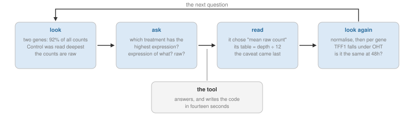{width=100%}

What caught the meaningless answer? Not the code: every line ran, and the only risky one —
`data.frame()`, which lines the two files up by position — found them in the same order.
Not a cleverer prompt: the tool raised the depth problem itself.

What caught it was looking before you asked — two group summaries like the ones you ran
all day, plus one thing no file holds: that two of the twelve genes are always on.

The method is Tukey's cycle from section 8, with the looking done first: look, ask, read
the answer against what you saw, look again. The tool changed one thing. Writing the code
used to force the first step; now nothing does, so you take it on purpose. Exact answers
are free. The right question was always the job.

---

# Where we are going

Next class the results stop being tables and start being figures — the other half of
looking — and the question of whether to trust what you see comes back in a new form,
because a figure can mislead in ways a number cannot.

## The habit to take with you

Class 4's habit was *guess the shape, then check*. Today's is the same habit, one level
up:

> **Look before you ask. Know what you would expect before you read the answer.**

Its smallest form takes two seconds: look at the row count before the answer — `dim()`
after every join, `n = n()` in every `summarise()` you will compare. An analysis wrong in
its shape is wrong in every number downstream, and none of the numbers will look wrong.

## Before next class

Knit this document. If it produces an HTML file, you are ready.
