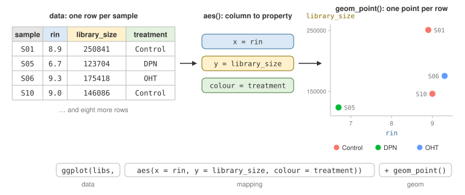

```{r setup, include=FALSE}
# Settings for the whole document; section 5 explains echo. It does not
# appear in the knitted output.
knitr::opts_chunk$set(echo = TRUE, collapse = TRUE)
```

Same collapsible notes as before: the explanation beside the first use, closed until you
want it.

---

# 1. Where you are

Last class answered its questions with tables. Class 5's section 8 said half of looking is
pictures. Today is that half.

A plot has two readers. First you: it is the fastest look at data you have. Then someone
else: a figure in a report or a talk has to say one thing, clearly. The first half of
today is the tool, **ggplot2**. The second half is what makes a figure good.

## The packages, and last class's tables

```{r}
library(readr)
library(dplyr)
library(tidyr)
library(ggplot2)
```

<details>
<summary>**`ggplot2`** — the plotting package</summary>

Part of the tidyverse, like the other three, so `install.packages("tidyverse")` already
installed it. If `library(ggplot2)` says *there is no package called 'ggplot2'*, run
`install.packages("ggplot2")` in the Console.

The "gg" is the **grammar of graphics** — section 2.

R also has its own plotting functions, such as Class 4's `hist()`. They work, but each has
its own arguments. ggplot2 builds every chart from the same few parts, so learning one
chart teaches you the next.

</details>

Now the tables from last class, rebuilt in one chunk. You have seen every line:

```{r}
counts <- read_csv("data/counts.csv", show_col_types = FALSE)
meta   <- read_csv("data/metadata.csv", show_col_types = FALSE)

long <- counts |>
  pivot_longer(-gene, names_to = "sample", values_to = "count")

libs <- long |>
  group_by(sample) |>
  summarise(library_size = sum(count)) |>
  left_join(meta, by = "sample")

cpm <- long |>
  group_by(sample) |>
  mutate(cpm = count / sum(count) * 1e6) |>
  ungroup() |>
  left_join(meta, by = "sample")
```

`counts` is the grid as read in. The other four are what you will plot — what one row of
each is:

- `meta` — one sample: patient, treatment, time, RIN. 12 rows.
- `long` — one gene in one sample, with its raw count. 144 rows.
- `libs` — one sample, with its library size and its row of `meta`. 12 rows.
- `cpm` — `long`, normalised to counts per million, with `meta` attached. 144 rows.

---

# 2. The grammar of graphics

Every ggplot2 chart is built from the same three parts:

- **data** — a table, one row per thing you will draw
- **aesthetic mapping** — which column drives which visual property: position across (x),
  position up (y), colour, size, shape
- **geom** — the mark drawn for each row: a point, a bar, a line, a box

{width=100%}

It is called a grammar because the parts combine like words in a sentence. Keep the data
and the mapping, change the geom, and you have a different chart.

One plot, built a layer at a time. The question: does a sample with better RNA (higher
RIN) get a bigger library?

*Predict:* the data alone, nothing else. What appears?

```{r}
ggplot(libs)
```

An empty grey panel. ggplot2 has the table but has not been told what to draw.

Add the mapping — `rin` across, `library_size` up:

```{r}
ggplot(libs, aes(x = rin, y = library_size))
```

Axes now, with ranges taken from the data. Still no marks.

Add the geom:

```{r}
ggplot(libs, aes(x = rin, y = library_size)) +
  geom_point()
```

Twelve points, one per row.

<details>
<summary>**`ggplot()`, `aes()`, `geom_point()`, and `+`**</summary>

`ggplot(data, aes(...))` starts a plot: the table, and the mapping every layer will use.

`aes()` — short for *aesthetics* — pairs a visual property with a column:
`aes(x = rin, y = library_size)`. Column names go in bare, as in `filter()`.

`geom_point()` adds a layer of points: one per row, placed by the mapping. Every chart
type is a different `geom_` function — section 3.

`+` adds a layer to a plot. Put it at the **end** of a line, never at the start of the
next one.

</details>

Add a third column, mapped to colour:

```{r}
ggplot(libs, aes(x = rin, y = library_size, colour = treatment)) +
  geom_point(size = 3)
```

The legend came free: map a column to colour — or size, or shape — and ggplot2 draws the
key. (`size = 3` makes every point bigger — more on that below.)

Read it. The point at bottom left is lowest on both: RIN 6.7, library 123,704. Which
sample? Ask the table:

```{r}
libs |> filter(rin < 7)
```

S05. Leave S05 out and there is no pattern: good RNA did not buy a bigger library. Now
read the colours. The four lowest RINs are all DPN. Nobody asked about that. The picture
raised it.

That is Class 5's cycle, with a picture doing the looking: look, ask the table, look
again.

## `+` is not `|>`

`|>` passes a table into a function. `+` adds a layer to a plot. A pipeline can end in a
plot, and from there on it is `+`:

```{r eval=FALSE}
libs |>
  filter(rin > 7) |>
  ggplot(aes(x = rin, y = library_size)) +
  geom_point()
```

Mix them up, and for once R stops you:

```{r error=TRUE}
ggplot(libs, aes(x = rin, y = library_size)) |>
  geom_point()
```

The message names the mistake. So does the other classic, `+` at the start of a line:

```{r error=TRUE}
ggplot(libs, aes(x = rin, y = library_size))
  + geom_point()
```

The first line was already a complete plot, so R drew the empty axes. Then
`+ geom_point()` stood alone, and R has nothing to add it to.

## Inside `aes()`, or outside

*Predict:* blue points?

```{r}
ggplot(libs, aes(x = rin, y = library_size)) +
  geom_point(aes(colour = "blue"))
```

Salmon-pink points, and a legend that says "blue". No error, no warning. **Not a crash — a
plausible picture.**

Inside `aes()`, `colour = "blue"` means *map colour to a column*. There is no such column,
so ggplot2 made one — every row holding the text "blue" — and gave that one group its
first default colour.

To **set** a colour for every point, put it outside `aes()`:

```{r}
ggplot(libs, aes(x = rin, y = library_size)) +
  geom_point(colour = "blue", size = 3)
```

- Inside `aes()`: taken **from a column**, so it changes with the data. Colour, size and
  shape get a legend.
- Outside: **one fixed value** for every mark. No legend.

`aes()` can sit inside `ggplot()`, as until now, and then it maps for every layer. Or
inside one geom, as in the blue example, and then it maps for that layer only.

---

# 3. Which chart, for which question

Pick the chart by the question you are asking, and by the kind of column it is about: a
number, or a category.

| Question | Chart | geom |
|---|---|---|
| What does one number's spread look like? | histogram, density | `geom_histogram()`, `geom_density()` |
| How does that spread differ between groups? | boxplot, violin | `geom_boxplot()`, `geom_violin()` |
| How do two numbers relate? | scatter | `geom_point()` |
| How many in each category, or one value per category? | bar | `geom_bar()`, `geom_col()` |
| How does something change over time? | line | `geom_line()` |
| What is the pattern across a whole grid? | heatmap | `geom_tile()` |

The scatter you have. Here are the other five.

## One number: histogram and density

What do the 144 counts in `long` look like? Two genes hold 92 per cent of all counts
(Class 5). *Predict:* what shape will the histogram have?

```{r}
ggplot(long, aes(x = count)) +
  geom_histogram()
```

One tall bar at the left, a few stragglers at the right. The stragglers are ACTB and GAPDH
— 24 values, all above 50,000. The other 120 are crushed into the first few bars.

The message is ggplot2 saying it chose 30 bins for you. Choose yourself with `bins =` (how
many bars) or `binwidth =` (how wide each one is).

The axis labels use Class 5's `1e6` notation: `5e+04` is 50,000. The x-axis is your
column, `count`. The y-axis is how many values fell in each bar — and ggplot2 labels that
`count` too.

Counts run from 40 to 125,567 — over three orders of magnitude. Put the axis on a log
scale:

```{r}
ggplot(long, aes(x = count)) +
  geom_histogram(bins = 30) +
  scale_x_log10()
```

Each labelled step on the axis is ten times the last. Now there are three groups: a small
one at the left (IL6, and PGR in the four OHT samples), most genes in the hundreds to
thousands, and the two housekeeping genes near 100,000. Counts are nearly always plotted
on a log scale, for exactly this reason.

A **density** plot is a smoothed histogram:

```{r}
ggplot(long, aes(x = count)) +
  geom_density() +
  scale_x_log10()
```

<details>
<summary>**`geom_histogram()`, `geom_density()`, `scale_x_log10()`**</summary>

`geom_histogram()` needs only `x`. It cuts the axis into bins and counts the rows in each,
so the y-axis is a count it made itself. `bins = 30` sets how many bins; `binwidth =` sets
how wide each is instead. Try a few — the shape can change.

`geom_density()` draws a smooth curve instead of bars. Its y-axis is not a count: the
curve is scaled so the area under it is 1. Read its shape, not its height.

`scale_x_log10()` puts the x-axis on a log scale: equal steps are equal *ratios* — 10,
100, 1,000. `scale_y_log10()` does the same for y. The data is not changed, only the axis.
A log scale cannot show zero, so a count of 0 would drop out with a warning.

</details>

## Between groups: boxplot and violin

Which genes change from sample to sample, and which hold steady? One box per gene, each
drawn from that gene's twelve samples:

```{r}
ggplot(cpm, aes(x = gene, y = cpm)) +
  geom_boxplot() +
  scale_y_log10()
```

Each box holds the middle half of one gene's twelve values, and the line across it is the
median; the note below has the rest. ACTB and GAPDH, at the top, are flat lines: the
housekeeping genes, the same in every sample. The tallest boxes are GREB1, PGR and TFF1,
with MYC and CCND1 next. Those genes change between samples. Keep them in mind.

The log axis matters here. Without it, ACTB and GAPDH would squash every other box flat.

<details>
<summary>**Reading a boxplot**, and `geom_violin()`</summary>

- the thick line — the **median**: half the values are above it
- the box — the middle half of the values, from the 25th to the 75th percentile
- the whiskers — out to the furthest value within 1.5 box-lengths of the box
- dots beyond — drawn one by one, as possible outliers

`geom_violin()` draws a density curve for each group, mirrored. It is wide where many
values sit, and narrow where few do. It shows what a box cannot: two clusters inside one
group, for instance.

</details>

A box shows five numbers. A **violin** shows the whole shape. Three of the tall ones:

```{r}
cpm |>
  filter(gene %in% c("TFF1", "GREB1", "PGR")) |>
  ggplot(aes(x = gene, y = cpm)) +
  geom_violin() +
  geom_boxplot(width = 0.1)
```

Two geoms in one plot: layers stack in the order you add them, so the thin boxes sit on
top of the violins. (`width = 0.1` is a fixed value, outside `aes()`, as in section 2.)

PGR is pinched in the middle, and GREB1 a little: two clusters of samples, with a gap
between. A box is a plain rectangle and cannot show that. Which samples sit low? A plot
further down answers that.

A violin needs a dozen or so values to have a shape, and even then it smooths: TFF1 has a
gap too, and its violin hides it. A group of only four — one treatment's samples, say — is
too few for a violin; plot the four points instead, as the bar section does.

## Categories: bar

A bar answers two different questions, with two different geoms.

**How many rows in each category?** `geom_bar()` counts them for you:

```{r}
ggplot(meta, aes(x = treatment, fill = time)) +
  geom_bar()
```

Class 5's `table(treatment, time)`, as a picture: four samples per treatment, two at each
timepoint. (`fill` colours the inside of a bar. `colour` would colour only its outline.)

**One value per category, already computed?** `geom_col()` draws the value you give it as
`y`:

```{r}
ggplot(libs, aes(x = sample, y = library_size, fill = treatment)) +
  geom_col()
```

Categories come out in alphabetical order. Order them by the value instead, with
`reorder()`:

```{r}
ggplot(libs, aes(x = reorder(sample, library_size), y = library_size,
                 fill = treatment)) +
  geom_col()
```

Now the ranking reads at a glance, and so does something else: the colours are mixed all
along the row. Depth did not follow treatment. (The x-axis label is now the code you
typed. `labs()`, in section 4, fixes that.)

<details>
<summary>**`geom_bar()` vs `geom_col()`**, and `reorder()`</summary>

`geom_bar()` takes only `x`, and counts the rows at each value — like `table()`.
`geom_col()` takes `x` and `y`, and draws the `y` you give it. If you already have the
number, it is `geom_col()`.

`reorder(sample, library_size)` puts the categories of `sample` in order of
`library_size`, smallest first. Use it anywhere a category sits on an axis.
`reorder(sample, -library_size)` gives largest first.

</details>

Now a question from Class 5's section 9 — how deeply was each treatment sequenced? — as a
bar of means:

```{r}
libs |>
  group_by(treatment) |>
  summarise(mean_library = mean(library_size)) |>
  ggplot(aes(x = treatment, y = mean_library)) +
  geom_col()
```

Three bars, nearly the same height, Control slightly taller. That is all a bar of a mean
can say. It does not say how many samples stand behind it, or how far apart they are.

The same question, with the samples drawn:

```{r}
ggplot(libs, aes(x = treatment, y = library_size)) +
  geom_point(size = 3)
```

Four points per treatment, and the spread inside any one treatment is bigger than the gap
between them. Control's top point is S01, at 250,841 — the deepest sample in the file.
Without it, Control would have the lowest mean of the three.

**A bar that counts rows and a bar of means are different plots.** A bar is right for a
number of rows. For a mean of a few values, show the values.

## Change over time: line

Class 5 ended on TFF1 at two timepoints. As a picture — the mean CPM per treatment at each
time:

```{r}
tff1 <- cpm |>
  filter(gene == "TFF1") |>
  group_by(treatment, time) |>
  summarise(mean_cpm = mean(cpm), .groups = "drop")

ggplot(tff1, aes(x = time, y = mean_cpm, colour = treatment)) +
  geom_line()
```

An empty panel and a message. No error.

ggplot2 draws one line per **group**. It makes a group for every combination of the text
columns in the mapping — and that includes `time`, on the x-axis. So each
treatment-and-time pair is a group: six groups, one point each. A line through one point
is nothing. Say which points belong together, with `group = treatment`:

```{r}
ggplot(tff1, aes(x = time, y = mean_cpm, colour = treatment, group = treatment)) +
  geom_line() +
  geom_point()
```

The lines spread apart: OHT falls further by 48h, DPN rises, Control stays about level.

A line says "this changed into that", so use one only when the x-axis has an order — time,
dose, age.

## Many small plots: facets

TFF1 was one gene. GREB1 and PGR moved too. All three, every sample, one panel per gene:

```{r}
cpm |>
  filter(gene %in% c("TFF1", "GREB1", "PGR")) |>
  ggplot(aes(x = treatment, y = cpm, colour = time)) +
  geom_point(size = 2) +
  facet_wrap(~ gene, scales = "free_y")
```

Same pattern in all three: OHT low, DPN high. Three panels, one glance.

<details>
<summary>**`facet_wrap()`**</summary>

`facet_wrap(~ gene)` draws one small panel per value of `gene`, each with the same geoms
and mapping. The `~` reads as "by".

`scales = "free_y"` gives each panel its own y-axis. Here that is necessary: TFF1 is in
the thousands to ten-thousands, PGR in the hundreds to a few thousand. The cost is that
heights can no longer be compared *between* panels, only within one. Leave it out and
every panel shares one axis.

</details>

## A whole grid: heatmap

All twelve genes in all twelve samples. A heatmap is a grid of tiles, each tile's colour a
value:

```{r}
ggplot(cpm, aes(x = sample, y = gene, fill = log10(cpm))) +
  geom_tile() +
  scale_fill_viridis_c() +
  facet_wrap(~ treatment, scales = "free_x")
```

The two bright rows are ACTB and GAPDH, on in every sample. The darkest is IL6, barely
there. In the OHT panel, TFF1, GREB1 and PGR are darker than elsewhere, and MYC and CCND1
a little. Those are the five tallest boxes from the boxplot: they varied between samples
because the treatments move them.

<details>
<summary>**`geom_tile()`**, `log10()` inside `aes()`, and
`scale_fill_viridis_c()`</summary>

`geom_tile()` draws one rectangle per row, at its `x` and `y`, filled by `fill`.

A mapping can hold a calculation, not only a column: `fill = log10(cpm)` colours by the
log of CPM, so the housekeeping genes do not wash out the rest.

`scale_fill_viridis_c()` swaps the default blues for the **viridis** palette: dark purple
to yellow, readable with colour-blindness and in greyscale. The `_c` is for a continuous
value; `scale_colour_viridis_d()` is the version for categories.

`facet_wrap(~ treatment, scales = "free_x")` groups the samples by treatment. `free_x`
lets each panel keep only its own four samples.

</details>

---

# 4. Making a figure readable

Every plot so far was for you. A figure for someone else needs words, a palette that works
for every reader, and less clutter. Here is the TFF1 plot, made presentable:

```{r}
tff1_plot <- ggplot(tff1, aes(x = time, y = mean_cpm,
                              colour = treatment, group = treatment)) +
  geom_line(linewidth = 1) +
  geom_point(size = 3) +
  scale_colour_manual(values = c(Control = "grey50", DPN = "#E69F00",
                                 OHT = "#0072B2")) +
  labs(title = "TFF1 falls under OHT and rises under DPN",
       x = "Time after treatment",
       y = "TFF1 (counts per million)",
       colour = "Treatment") +
  theme_minimal(base_size = 14)

tff1_plot
```

Three changes, besides bigger points and a thicker line:

- **`labs()`** — a title that says the finding, and axis labels a stranger can read, with
  units.
- **`scale_colour_manual(values = ...)`** — you pick the colour for each group, by name.
  Grey for Control, the baseline. Orange and blue for the two drugs: that pair stays
  distinct for colour-blind readers, and in grey print. The defaults do not. In section
  3's line plot, Control's salmon-red and DPN's green are equally bright, and to a
  red–green colour-blind reader — about one man in twelve — they look alike. Printed in
  grey, all three default colours come out the same grey.
- **`theme_minimal(base_size = 14)`** — drops the grey background, and makes the text big
  enough for a projector.

A plot is an object: `tff1_plot <- ...` stores it, and typing its name draws it.

<details>
<summary>**`labs()`**, the colour scales, and themes</summary>

`labs()` sets any label: `title`, `subtitle`, `caption`, `x`, `y`, and one per mapping —
`colour =`, `fill =` — for the legend's title. Set one to `NULL` to remove it:
`labs(y = NULL)`.

Colour scales come in pairs, one per mapping. `scale_colour_...` changes `colour`,
`scale_fill_...` changes `fill`:

- `scale_colour_manual(values = ...)`, `scale_fill_manual(...)` — your own colour for
  each group, as `group = colour` pairs inside `c()`. A group whose name starts with a
  digit goes in quotes: `c("24h" = "#56B4E9", "48h" = "#0072B2")`.
- `scale_colour_viridis_d()`, `scale_fill_viridis_c()` — viridis, for categories (`_d`) or
  numbers (`_c`).

Themes set everything that is not data: `theme_minimal()`, `theme_bw()`,
`theme_classic()`. `base_size` is the text size in points; the default is 11. Add
`theme(legend.position = "bottom")` after one to move the legend under the plot, which
gives side-by-side panels the full width.

A colour is either a name R knows, such as `"grey50"`, or a **hex code** such as
`"#E69F00"` — amounts of red, green and blue, in the form any colour picker gives you.
Orange `#E69F00`, sky blue `#56B4E9`, blue `#0072B2` and bluish green `#009E73` come from
the **Okabe–Ito** palette, designed to stay distinct for colour-blind readers.

`linewidth = 1` in `geom_line()` sets line thickness, as a fixed value outside `aes()`.

</details>

Save it:

```{r}
dir.create("results", showWarnings = FALSE)
ggsave("results/tff1_over_time.png", tff1_plot, width = 7, height = 4.5)
```

<details>
<summary>**`ggsave()`**</summary>

`ggsave(file, plot, width, height)` writes a plot to a file. The ending picks the format:
`.png` for slides and documents, `.pdf` for print. `width` and `height` are in inches.
Leave out `plot` and it saves the last plot you made — naming it is safer.

</details>

---

# 5. Figures in a report

A figure pasted into a report is a picture of an analysis. A figure in a knitted document
is the analysis: it is rebuilt from the data every time you knit. Change the data, knit,
and every figure follows.

Chunk options, the braces from Class 4, control how a figure appears:

- `fig.width=6, fig.height=3.5` — its size, in inches
- `fig.cap="..."` — a caption underneath
- `echo=FALSE` — show the figure, hide the code
- `message=FALSE` — hide messages, such as the bins message above

Together, for a reader who wants the result and not the R:

````{verbatim}
```{r fig.width=6, fig.height=3.5, echo=FALSE, fig.cap="Library size per sample, smallest first."}
ggplot(libs, aes(x = reorder(sample, library_size), y = library_size,
                 fill = treatment)) +
  geom_col() +
  scale_fill_manual(values = c(Control = "grey50", DPN = "#E69F00",
                               OHT = "#0072B2")) +
  labs(x = "Sample", y = "Library size", fill = "Treatment") +
  theme_minimal()
```
````

which knits to:

```{r fig.width=6, fig.height=3.5, echo=FALSE, fig.cap="Library size per sample, smallest first."}
ggplot(libs, aes(x = reorder(sample, library_size), y = library_size,
                 fill = treatment)) +
  geom_col() +
  scale_fill_manual(values = c(Control = "grey50", DPN = "#E69F00",
                               OHT = "#0072B2")) +
  labs(x = "Sample", y = "Library size", fill = "Treatment") +
  theme_minimal()
```

To hide the code in every chunk of a report at once, use the settings chunk at the top of
the `.Rmd`. The knitted page hides that chunk, so look for it in the `.Rmd`. It holds a
line like `knitr::opts_chunk$set(echo = TRUE, collapse = TRUE)`; for a report, make it:

```{r eval=FALSE}
knitr::opts_chunk$set(echo = FALSE)
```

`knitr` is the package that does the knitting. `collapse = TRUE` keeps each result in the
same grey box as its code. This document keeps `echo = TRUE`, because here the code is the
point.

---

# PRACTICE A

Fifteen minutes. Type each answer into the chunk under its question, and write one
sentence under each plot saying what you see.

The QC sheet from Class 4's Practice B: one row per sample tube, with the patient's age
and sex, the batch it was processed in, its RIN, and the facility's QC score out of 100.
Before anyone compares the batches, look at the sheet — one picture per question.

One rule first. ggplot2 cannot place a missing value, so it drops any row missing a value
the plot needs, and says so in a warning that starts *Removed … rows*. (Some plots call a
missing value *non-finite* instead.)

Read it in, and look at it with `glimpse()` — Class 5's one line per column: its name, its
type, and its first few values.

```{r}
qc <- read_csv("data/qc_samples.csv", show_col_types = FALSE)
glimpse(qc)
```

**1.** RIN: what does its spread look like? Use `bins = 10`, and `colour = "white"` to
outline each bar. What does the warning say, and which rows is it about?

```{r try-a1}
```

**2.** How many rows in each batch? One batch has an extra. Why?

```{r try-a2}
```

Q07 is in the sheet twice — the duplicate Class 4 found. This keeps each sample once.
`duplicated(sample_id)` is `TRUE` for the second Q07 and `FALSE` for every other row; `!`
flips that, so `filter()` keeps every row except the repeat:

```{r}
qc1 <- qc |>
  filter(!duplicated(sample_id))

dim(qc1)
```

25 rows in, 24 out. Use `qc1` from here on.

**3.** Draw question 2 again, from `qc1`.

```{r try-a3}
```

**4.** Does the QC score track RIN? One sentence.

```{r try-a4}
```

**5.** Does one batch look worse? QC score by batch, as boxes with the tubes drawn on top.
Which batch has the lowest median, and does that make it worse?

```{r try-a5}
```

**6.** Do older patients give lower RIN? Age against RIN, coloured by sex. How many rows
did ggplot2 drop this time, and why that many?

```{r try-a6}
```

**7.** Make question 5's plot readable by a stranger — labels, a title that says what you
found, a clean theme — and save it as `results/qc_by_batch.png`.

```{r try-a7}
```

---

# 6. What makes a good graph

**Slides: [Visualization
principles](https://docs.google.com/presentation/d/1c_O3A0ssEpVWJ_nWiu4rEzKZjiHQiB_yEO7P4keRhhQ/edit?usp=sharing)**

The slides draw on one review paper, worth keeping: Franconeri, Padilla, Shah, Zacks and
Hullman (2021), [The Science of Visual Data Communication: What
Works](https://journals.sagepub.com/doi/pdf/10.1177/15291006211051956), *Psychological
Science in the Public Interest*.

## The questions to ask of any figure

1. **What is the one thing it should show?** Does the title say it?
2. **Is the comparison that matters made by position?** Position on a shared axis is read
   most accurately — then length, then angle and area, then colour. That is why a dot or a
   bar beats a pie slice. Things to compare go side by side, on one axis.
3. **Do the bars start at zero?** A bar's length is its value. Points and lines need not
   start at zero.
4. **Are the data shown, or only a summary?** With a handful of values, show them.
5. **Does the colour work for everyone?** Colour-blind-safe, still readable printed in
   grey, and only a few colours.
6. **Can the reader match without searching?** Labels near what they label; categories in
   a meaningful order, not alphabetical.
7. **Do panels that get compared share an axis?**

---

# PRACTICE B

Fifteen minutes, in pairs. Three figures, each drawn from this data for a stated purpose,
and each with problems. For each figure:

1. Read what it is for.
2. Say which of the seven checklist questions above it fails.
3. Say what a reader would wrongly take from it.

Then pick one of the three and rebuild it so it does its job.

The code behind each figure is in the note under it.

## Figure 1

*What it is for:* to show whether the three treatments were sequenced to the same depth —
the check Class 5 said to make before comparing raw counts across treatments.

```{r bad1, echo=FALSE}
libs |>
  group_by(treatment) |>
  summarise(mean_library = mean(library_size)) |>
  ggplot(aes(x = treatment, y = mean_library, fill = treatment)) +
  geom_col() +
  coord_cartesian(ylim = c(170000, 185000), expand = FALSE) +
  labs(title = "Control expresses the most RNA", y = "RNA")
```

<details>
<summary>The code behind Figure 1</summary>

```{r ref.label="bad1", eval=FALSE}
```

`coord_cartesian(ylim = ...)` zooms the y-axis to that range, and `expand = FALSE` stops
ggplot2 adding its usual margin.

In your `.Rmd` this chunk looks empty. `ref.label="bad1"` tells it to show the code of
the chunk named `bad1` — the one that drew the figure.

</details>

```{r try-b1}
```

## Figure 2

*What it is for:* to show how the reads are shared out among the twelve genes — which
genes take most of them, and how the other ten compare with one another.

```{r bad2, echo=FALSE}
totals <- long |>
  group_by(gene) |>
  summarise(total = sum(count))

ggplot(totals, aes(x = "", y = total, fill = gene)) +
  geom_col() +
  coord_polar(theta = "y") +
  labs(title = "Where the reads go")
```

<details>
<summary>The code behind Figure 2</summary>

```{r ref.label="bad2", eval=FALSE}
```

A pie chart in ggplot2 is one stacked bar, bent into a circle by `coord_polar()`;
`theta = "y"` says the y-axis is the one that goes round. `x = ""` puts all twelve genes
into that one bar.

</details>

```{r try-b2}
```

## Figure 3

*What it is for:* to show, for each of three estrogen-responsive genes — TFF1, GREB1 and
PGR — how the two drugs move it against Control, and whether the effect is different at
24h and 48h.

```{r bad3, echo=FALSE}
cpm |>
  filter(gene %in% c("TFF1", "GREB1", "PGR")) |>
  ggplot(aes(x = gene, y = cpm, colour = time)) +
  geom_point(size = 2) +
  facet_wrap(~ treatment, scales = "free_y") +
  scale_colour_manual(values = c("red", "green")) +
  labs(title = "Estrogen-responsive genes")
```

<details>
<summary>The code behind Figure 3</summary>

```{r ref.label="bad3", eval=FALSE}
```

`scale_colour_manual(values = ...)` sets the colours by hand.

</details>

```{r try-b3}
```

---

# Where we are going

TFF1 falls under OHT at both timepoints — section 4's line plot shows it. But each point
on that plot is a mean of two samples. Is a drop that size real, or could two samples give
it by chance? A picture cannot settle that. A test can — Class 7.

## The habit to take with you

Class 4's habit was *guess the shape, then check*. Class 5's was *look before you ask*.
Today's is the same habit, with pictures:

> **Plot before you trust a summary. Before you show a plot, know the one thing it should
> say.**

## Before next class

Knit this document. If it produces an HTML file with every figure in it, you are ready.
